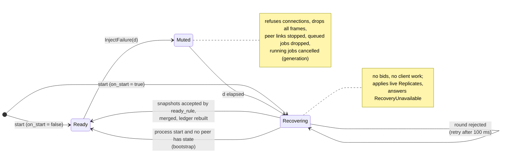
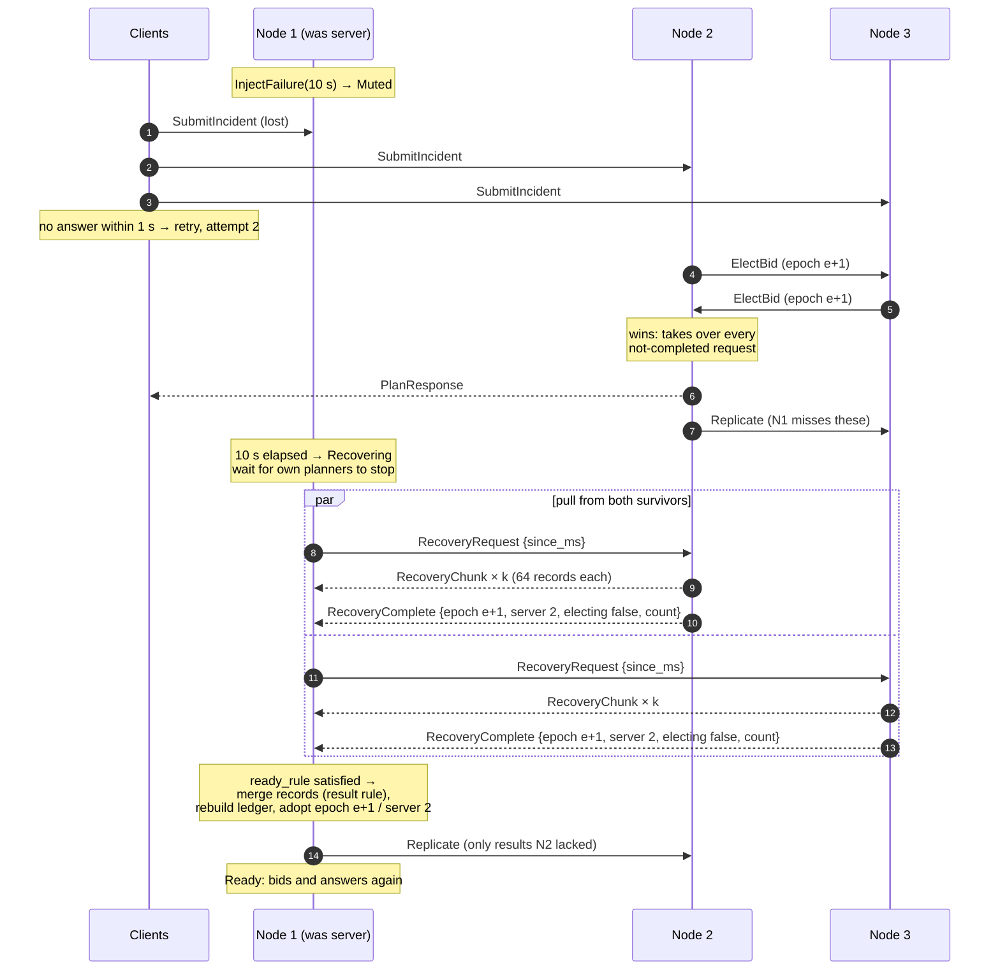
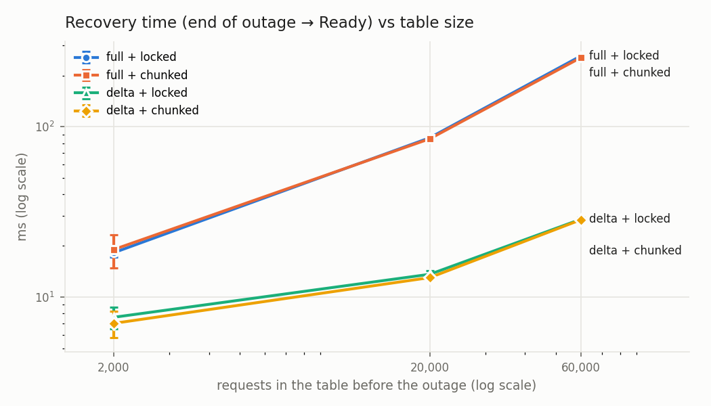
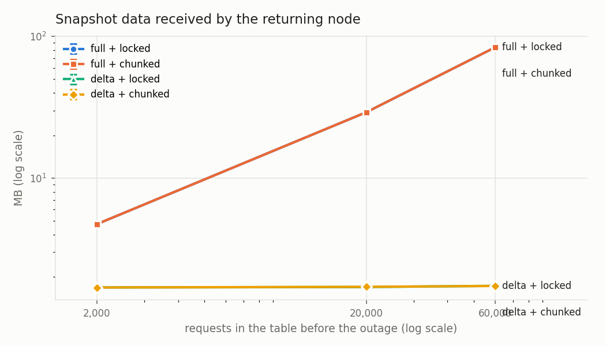
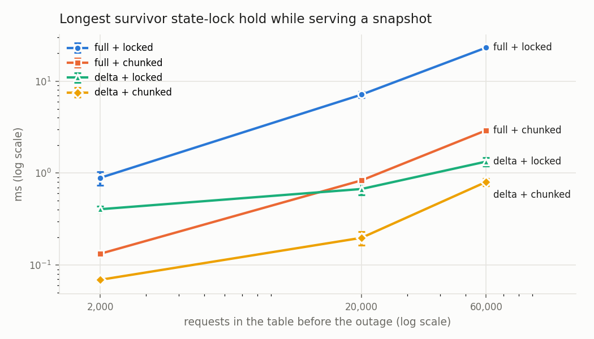
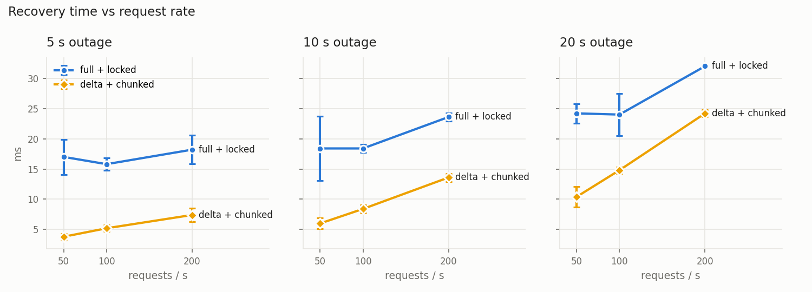
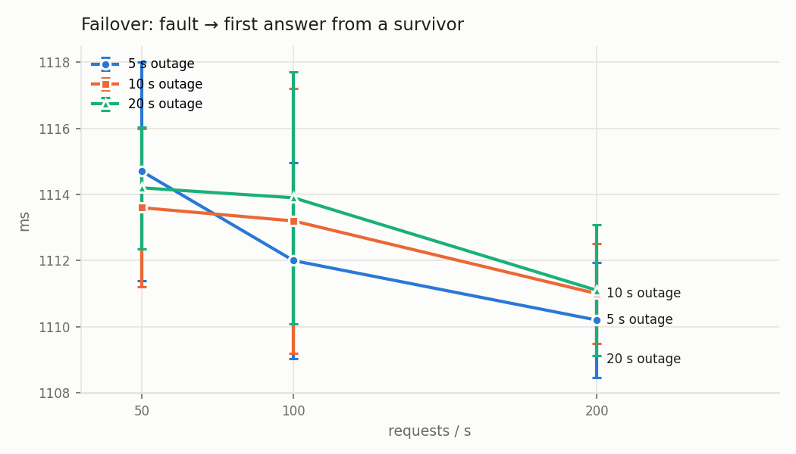

# Server recovery: design, decisions and measurements

This is the recovery part of Phase 1: a cloud node that was unreachable comes
back, makes its state consistent with its peers, and only then takes part again.
It covers what state must be recovered and how, the protocol, every decision
taken with the alternatives we tried, and the measurements that justify them.

The first version of recovery after a temporary failure was merged in PR 38
(`feature/temporary-failure-recovery`). This document builds on it: each of its
choices became a switch in the `[recovery]` config section, alternatives were
implemented next to it, and the experiments in [Results](#results) compare them
on the same workloads. The defaults chosen from the measurements are in
[Final choices](#final-choices): delta transfer, chunked snapshots, the
majority ready rule, and recovery on process start.

Related: [protocol.md](protocol.md) (message formats),
[concurrency-and-failures.md](concurrency-and-failures.md) (fault injection,
thread model), [design-log.md](design-log.md) (all other decisions).

## 1. The problem

The project specification asks for four things on revival (§ "Fault injection
and recovery"):

1. requests in flight at the time of the failure are detected, retried or
   completed;
2. duplicate execution is prevented or made harmless;
3. the recovery protocol says what state is copied, replayed or reconstructed,
   and how the returning node knows it is sufficiently current;
4. failover time and recovery/convergence time are measured under different
   loads.

### Fault model

| Fault | How it is produced | What the node keeps |
|---|---|---|
| **Temporary failure (mute)**: the spec's "ignore communication" | `InjectFailure {duration_ms}` (1–20,000 ms). The node refuses connections, drops every inbound frame and stops its peer links. | Everything in memory, but stale: it missed every message sent during the outage. |
| **Crash and restart** | The process is killed (`SIGKILL`) and started again. | Nothing. Tables and ledger are in memory only. |

Assumed: one node fails at a time (the spec's scenario); messages are not
forged; clocks may differ between machines (nothing below compares timestamps
across machines).

## 2. What state a node holds, and how each part is recovered

| State | What it is | Recovered by | Why |
|---|---|---|---|
| **Results table** | request → final plan (`served_by`, epoch, plan) | **Copied** from the survivors | It is the outcome clients were told; it must be identical on all nodes. |
| **Request table** | every request seen: attempt, epoch, incident, complexity, completed? | **Copied** from the survivors | A future server takes over the not-completed ones; a retry must be recognised. |
| **Ledger** | which responder / resource units are held by which request, until when | **Reconstructed** locally from the merged results | It is a pure function of the set of plans (each plan's assignments are the holds) and the ledger's conflict rule is order-independent (D12), so rebuilding it gives exactly what the survivors hold, without shipping it. |
| **Role view** | current epoch and server | **Copied**: adopted from the survivors' snapshot | Otherwise the node starts an election just to learn who serves (D30), or wins one while stale. |
| **Election state** | open elections, own bids, tenure | **Reset** | Elections that ran while the node was away are over; old timers are invalidated by the outage generation. |
| **Planner queue and in-flight jobs** | work the node had accepted | **Discarded** | The survivors' new server took those requests over (they are in its request table); finishing them here would only produce late duplicates. |
| **Reply channels** | which client connection waits for which request | **Discarded** | The clients have retried on their other connections. |

Nothing is **replayed**: there is no operation log. This is the central design
point. Results merge by a deterministic rule (higher epoch, then lower
`served_by`, D27) and the ledger by another (higher priority keeps the
responder, D12); both give the same answer whatever order entries arrive in. So
the returning node can apply snapshots and live replicas in any order and still
end where the survivors are. That makes a simple, unordered state transfer
correct; an ordered log would be needed only if the merge were not commutative.

## 3. The protocol

### Phases of a node



### One recovery, message by message



### Step by step

1. **Silence (Muted).** The outage generation counter is incremented. Queued
   planning jobs are dropped; jobs already running finish computing but cannot
   commit to the ledger or publish (their generation is stale); election timers
   from before the outage are ignored. Peer links stop and their queued frames
   are discarded.
2. **Drain.** When the outage ends, the node waits until its own planner threads
   are idle, so no old job can touch the ledger it is about to replace.
3. **Pull.** It opens a dedicated connection to each peer and sends
   `RecoveryRequest`. A Ready peer answers with its records in chunks of 64 and a
   trailer carrying the record count and its role view (epoch, server, whether
   it is electing). A peer that is not Ready answers `RecoveryUnavailable` at
   once. Each transfer has a 10 s limit; a short or interrupted transfer is
   discarded.
4. **Accept or retry.** The round is accepted if it meets the `ready_rule`
   (section 4, R4); otherwise the node waits 100 ms and pulls again. If a live
   `Replicate` from a newer epoch arrived during the transfer, the round is
   discarded too: never install an older role view over a newer one.
5. **Install** (under the state lock). Merge every snapshot's records through
   the same `offer` path as live replication; rebuild the ledger from all
   retained plans; adopt the epoch and server; clear election state.
6. **Republish.** Results this node holds that a survivor's snapshot lacked (or
   held in a version the result rule replaces) are sent to that survivor as
   `Replicate`. This covers a result the node finished just before it went
   silent, whose replica never left.
7. **Ready.** Peer links resume. If the adopted role view names this node as the
   server, it takes over not-completed requests like any new server.

### Requests in flight at the time of the failure (spec point 1)

| Where the request was | What happens |
|---|---|
| Queued on the failed server, not started | Dropped at the mute. The client gets no answer, times out (1 s) and retries to all three nodes; the retry triggers an election; the new server takes over every not-completed request in its request table, oldest first. |
| Running on the failed server | Computed but cancelled by the generation check: no ledger effect, no reply, no replica. Then as above. |
| Finished, reply sent, replica not yet sent | The client has its answer. The survivors lack the result; the new server recomputes it when the request is taken over, or the client's next retry is answered. When the failed node returns, step 6 republishes its result; the result rule picks one version everywhere (D27). |
| Sent by a client during the outage | Never reaches the failed node; the survivors handle it. The returning node gets it in the snapshot. |
| Arriving while the node is Recovering | Ignored by that node (it does not record or serve); the survivors answer it, and the result reaches it by live replication or the snapshot. |

### Duplicate execution (spec point 2)

Every operation carries a `request_id`; retries reuse it with a higher attempt
number. A node that already holds the result answers from the results table
instead of planning again. Where a request is planned twice anyway (a server
stepped down mid-job, or the failed node's result is republished next to the
new server's), the two results meet in the results table and **the same one
wins on every node** (higher epoch, then lower `served_by`); the loser's ledger
holds are released. So duplicates can happen but are harmless: one plan per
request survives everywhere, and the client may at worst have received the
losing plan (counted as `late_results`, see D27).

### "Sufficiently current" (spec point 3)

The returning node is current enough when:

- it has merged the snapshot of every survivor the `ready_rule` requires, each
  complete (count checked) and taken while that survivor was Ready and not in
  the middle of an election;
- the role view it adopts is not older than any epoch it observed live during
  recovery;
- its own planners are idle and its ledger was rebuilt from the merged results.

Snapshots are point-in-time cuts of each survivor, not an atomic cut of the
cluster: results completed during the transfer reach the node afterwards by
normal replication, which it already applies while Recovering. Convergence is
therefore checked at the end of every experiment run: all live nodes'
`results_digest` values must be equal once the workload has settled.

## 4. Decisions

Each decision lists the alternatives, the choice, and the reason. Where the
alternatives were implemented, the [Results](#results) section has the numbers;
the `[recovery]` key that switches it is given.

### R1. Pull from the survivors vs. push to the returning node vs. replaying the peer backlog
- **Alternatives:** (a) the survivors notice the node is back and push what it
  missed; (b) the peer links keep everything sent during the outage and deliver
  it on reconnect (what happened by accident before PR 38, design log
  limitation a); (c) the returning node pulls a snapshot.
- **Choice:** (c), pull.
- **Reason:** the returning node is the only one that knows it was away and
  when it came back; with no heartbeats (D15) the survivors would have to add
  failure detection just to push. The backlog (b) is bounded by frame count
  (4,096 per peer, ≈80 s at 50 req/s), silently loses everything beyond, and
  replays stale election bids. A pull is explicit, bounded and checkable (record
  count in the trailer).

### R2. What to transfer: full snapshot vs. delta vs. operation log (`transfer`)
- **Alternatives:** (a) **full**: every retained request and result (tables keep
  entries 30 min, D38); (b) **delta**: only entries the survivor changed since
  the outage began; (c) a sequence-numbered operation log replayed from the
  node's last position.
- **Choice:** see [Final choices](#final-choices); (a) and (b) were both
  implemented and measured.
- **How delta stays correct:** each table entry records when it last changed
  (created, a higher attempt arrived, a result was stored or replaced). The
  returning node asks for "the last *d* ms", where *d* = time since its outage
  began + `delta_margin_ms` (2 s), measured on its own clock; the survivor
  selects by its own clock. Only durations cross the network, so clock skew
  between machines does not matter. Everything older than the window the node
  already received before it went silent; the margin covers replicas that were
  in flight at that moment (replication is sent within milliseconds of a
  result, so 2 s is two to three orders of magnitude of headroom). A process
  that just started has nothing to build on and always pulls everything.
- **Why not (c):** a log needs a total order of operations across nodes, which
  the system deliberately does not have (results are replicated asynchronously
  by whichever node served them). Because the merge is order-independent
  (section 2), a set of changed entries is enough; a log would add ordering we
  do not need.
- **Cost of full:** grows with the table, i.e. with how long the cluster has been
  running, not with how long the node was away. **Cost of delta:** grows with
  rate × outage length; it relies on in-memory state surviving the outage
  (true for a mute, not for a crash, which is why a restart uses full).

### R3. How a survivor builds the snapshot: one lock hold vs. chunked (`snapshot`)
- **Alternatives:** (a) **locked**: copy every record and queue every chunk
  while holding the node's state lock; (b) **chunked**: copy only the sorted key
  list under the lock, then 64 records per lock hold, releasing it in between.
- **Choice:** see [Final choices](#final-choices).
- **Why it matters:** the survivor answering a snapshot is often the *server*.
  Every client request it handles needs the same state lock, so while it is
  held for the whole copy, request handling on the server stops. (b) bounds each
  hold to 64 records. Entries swept between holds are skipped; entries changed
  between holds are sent as they are now, which the result rule makes safe.
- **Measured as:** the survivor's longest single lock hold while serving a
  snapshot (`snapshot_lock_max_us`), and client latency during the recovery.

### R4. When to trust what was pulled: both survivors vs. a majority (`ready_rule`)
- **Alternatives:** (a) **both_agree**: both survivors answered, report the
  same epoch and server, and neither is electing (PR 38); (b) **majority**: one
  non-electing survivor answered (the returning node + 1 = 2 of 3, the same
  quorum as elections, D19); the second is waited for up to
  `majority_wait_ms` (500 ms) and merged if it arrives; the highest epoch seen
  wins.
- **Choice:** see [Final choices](#final-choices).
- **Trade-off:** (a) never resumes on one survivor's view, but cannot finish if
  a second node is down or unreachable: the node stays Recovering, serving
  nothing, until both are back. (b) finishes with one survivor; a result that
  only the missing survivor holds is not lost but arrives later, when that
  survivor recovers and republishes it (step 6), and the result rule keeps
  every node's choice the same. Both rules exclude a survivor that is electing.
- **Bug found while testing:** with `on_start`, when all three processes start
  together the first one to bootstrap becomes Ready; each of the other two then
  sees one Ready peer and one "starting, empty" peer, and under (a) each waits
  for the other's agreement forever. Fix: a peer that answers
  `RecoveryUnavailable {has_state: false}` holds nothing to agree on and is left
  out of the count (test `restarted_process_recovers_from_peers_before_serving`).

### R5. A restarted process: start Ready and empty vs. recover first (`on_start`)
- **Alternatives:** (a) a (re)started process is Ready at once with empty tables
  (PR 38: "cold restart is not claimed"); (b) it starts Recovering, pulls a full
  snapshot, and only then serves; if no peer is Ready (the whole cluster is
  starting, or nobody is reachable for `boot_wait_ms` = 2 s), it bootstraps
  Ready and empty, because nobody holds state to fetch.
- **Choice:** see [Final choices](#final-choices).
- **Why (a) is harmful (measured, section Results):** the restarted node knows
  no server and epoch 0. The first request it sees carries the client's newer
  epoch, which it adopts with the server unknown (D30), triggering an election
  the healthy cluster did not need. Its queue is empty, so its load bid is the
  lowest and it can win (design-log limitation b); it then plans on an empty
  ledger, handing out responders the others already assigned (replicate
  conflicts), and its results table never regains what was served before the
  crash, so the tables never agree again.
- **Demo relevance:** the spec's failure is a mute, but someone closing a node
  window during the demo is a crash; (b) makes that recover too.

### R6. Rebuild the ledger rather than copy it
- **Alternatives:** ship the ledger in the snapshot; rebuild it from the merged
  plans.
- **Choice:** rebuild (PR 38; kept).
- **Reason:** the ledger is derived state (section 2). Shipping it would mean a
  second structure that must agree with the results it derives from; rebuilding
  cannot disagree. Cost: one pass over the retained plans under the returning
  node's own state lock, while it is not serving (`install_ms` in the results).

### R7. A recovering node does not bid or serve
- **Alternatives:** serve from whatever it has while catching up; bid but not
  serve; neither.
- **Choice:** neither (PR 38; kept).
- **Reason:** a stale node with an empty queue has the lowest load score and
  would win elections (limitation b). Not serving costs nothing: the two
  survivors are already serving.

### R8. Answer "not ready" instead of staying silent
- **Before:** a peer that was not Ready ignored a `RecoveryRequest`, so the
  requester waited out the full 10 s transfer limit before retrying.
- **Now:** it answers `RecoveryUnavailable {phase, has_state}` at once. This also
  provides the `has_state` signal R4 and R5 need.

### R9. Keep the results digest incrementally (measurement hygiene)
- **Before:** every `Status` query serialized the whole results table to compute
  its digest, under the state lock (≈ tens of ms at 20,000 entries), so polling
  a node during an experiment slowed the very node being measured.
- **Now:** the digest (a wrapping sum of per-entry hashes) is updated on every
  store, replace and sweep. Unit test
  `incremental_digest_matches_a_full_recount`.

## 5. Experiments

### Method

`scripts/recovery_bench.py` runs every experiment against real processes:

1. start three `cloud-node` release binaries on 127.0.0.1 with the variant's
   `[recovery]` section (3 planner workers each, `cpu_source = "process"`,
   request timeout 1 s, 8 attempts);
2. fill the tables to the target size with cheap requests (complexity 1), then
   elect a server with one warm-up request;
3. start an open-loop client workload (fixed rate, complexity 5) that spans 3 s
   before the fault, the outage, and 6 s after;
4. after 3 s, fail the **elected server** (mute for *d* ms, or kill and restart
   after *d* ms); in the ready-rule experiment also kill one survivor 0.5 s later;
5. wait for the victim to become Ready (or a limit), let the workload finish,
   wait until no node has queued or running work, and record one summary row.

Each cell is repeated (5 times unless stated); the tables show mean ± 95 %
confidence interval (Student t). Every run starts fresh processes.

### Metrics

| Metric | Definition |
|---|---|
| failover time | fault → first answer from a survivor to a request sent after the fault |
| recovery time | end of the outage (or process start) → Ready, from the node's own report; split into drain, fetch (last round), install |
| records / bytes received | snapshot contents the returning node received in the accepted round |
| new results | results it did not hold before the merge (what it actually missed) |
| survivor lock hold | longest single hold of a survivor's state lock while serving a snapshot |
| client latency windows | p50/p99 of requests *sent* before the fault, during the outage, and from the end of the outage to Ready + 1 s |
| tables agree | all live nodes report the same `results_digest` after the run settles |
| replicate conflicts | replicated plans that assigned a responder already held by another request |

### Reproduce

```bash
cargo build --release
python3 scripts/recovery_bench.py all --reps 5     # ≈ 1.5 h on a laptop
python3 scripts/recovery_report.py                 # tables + figures
```

On the six lab PCs: [lab-experiments.md](lab-experiments.md) (same
experiments, `--lab lab.json`, results in `experiments/recovery/lab/`).

Raw per-request client logs: `experiments/recovery/raw/` (one CSV per run,
columns as in the client's `--out` file). Summary rows:
`experiments/recovery/{transfer,load,ready_rule,restart}.csv`.

## Results

170 runs in four experiments, 5 repetitions per cell, on one MacBook (see
Limitations). **Every request in every run was answered** (0 failed, never more
than 2 attempts in the mute experiments), and **all live nodes' results tables
were identical at the end of every run** except the deliberate "restart without
`on_start`" case. Full tables with 95 % confidence intervals:
[experiments/recovery/summary.md](../experiments/recovery/summary.md); raw rows
in the CSVs next to it.

### R2: full vs. delta transfer



Elected server muted for 10 s at 100 req/s; tables pre-filled to 2,000, 20,000
or 60,000 requests (30 min of retention at 200 req/s is 360,000).

| table | transfer | records received | MB received | recovery ms |
|---|---|---|---|---|
| 2,000 | full | 6,604 | 4.7 | 18.2 ± 1.0 |
| 2,000 | delta | 2,401 | 1.7 | 7.6 ± 1.1 |
| 20,000 | full | 42,604 | 29.2 | 86.2 ± 1.0 |
| 20,000 | delta | 2,401 | 1.7 | 13.6 ± 0.7 |
| 60,000 | full | 122,604 | 83.6 | 260.2 ± 1.4 |
| 60,000 | delta | 2,401 | 1.7 | 28.6 ± 0.7 |

(locked snapshots shown; chunked gives the same records and times within the
confidence intervals.)

- **Full transfer grows with the table**: 4.7 → 83.6 MB and 18 → 260 ms as the
  table grows 30×. That is the cost of how long the cluster has been running,
  paid on every recovery even when the node was away for a moment.
- **Delta stays at 2,401 records (1.7 MB) whatever the table size**: it depends
  only on what happened during the outage (10 s × 100 req/s from each survivor,
  plus the 2 s margin). At 60,000 entries it is **49× less data and 9× faster**.
- What remains of delta's time at large tables is **install** (21 ms at 60,000):
  rebuilding the ledger from every retained plan (R6). It runs on the returning
  node, which is not serving yet, so nobody waits on it.
- Over the network in the lab the gap should be larger: 84 MB per survivor is
  a large transfer for a 20 s outage; 1.7 MB is not.



### R3: snapshot built in one lock hold vs. chunked



| table | full + locked | full + chunked | delta + locked | delta + chunked |
|---|---|---|---|---|
| 2,000 | 0.89 ms | 0.13 ms | 0.41 ms | 0.07 ms |
| 20,000 | 7.12 ms | 0.83 ms | 0.67 ms | 0.20 ms |
| 60,000 | 23.10 ms | 2.91 ms | 1.33 ms | 0.80 ms |

Longest single hold of a survivor's state lock while it built a snapshot
(mean of 5 runs). While it is held, that survivor (often the server) cannot
accept, record or answer any request.

- **Chunking cuts the longest hold 7–8×** for full transfers (23.1 → 2.9 ms at
  60,000) and 2–3× for delta.
- **Delta also shortens the hold**, because there is less to copy: delta +
  locked (1.3 ms) already beats full + chunked (2.9 ms) at 60,000.
- **Honest result:** at 100 req/s the client's p99 latency during recovery did
  not change measurably (10.0 ± 4.5 ms full + locked vs 9.1 ± 2.2 ms full +
  chunked at 60,000; ≈7 ms for delta). One 23 ms hold every recovery is hit by
  only 2–3 requests at that rate, too few to move a p99. The hold is a
  worst-case stall that grows with table size and rate (a 360,000-entry table
  would mean ≈140 ms of a frozen server, extrapolating linearly); chunking
  bounds it at the cost of nothing measurable (recovery times equal within the
  intervals).

### Recovery and failover vs. load and outage length



2,000-request table, mute of the elected server, 50 / 100 / 200 req/s × 5 / 10 /
20 s outages, original (full + locked) vs. delta + chunked. 90 runs.

| req/s | outage | new results (what it missed) | full: records / recovery ms | delta: records / recovery ms |
|---|---|---|---|---|
| 50 | 5 s | 250 | 4,804 / 17.0 ± 2.9 | 702 / 3.8 ± 0.6 |
| 100 | 10 s | 1,000 | 6,604 / 18.4 ± 0.7 | 2,402 / 8.4 ± 0.7 |
| 200 | 20 s | 4,000 | 13,205 / 32.0 ± 0.0 | 8,802 / 24.2 ± 0.6 |

(all nine cells in summary.md)

- **What the node missed is exactly rate × outage** (250 at 50 req/s × 5 s up to
  4,000 at 200 req/s × 20 s), and both variants recover all of it: every run
  ended with identical tables.
- **Delta's cost tracks what was missed**, full's tracks the table plus what was
  missed. Delta is 1.3–4.5× faster here even on a small (2,000) table; the gap
  is largest for short outages, which are the common case.
- **Recovery is milliseconds; failover is about a second.** The returning node
  is Ready 4–32 ms after its outage ends, while clients saw the failure for
  about a second (below): recovery is not on the clients' critical path,
  because the survivors keep serving throughout.



- **Failover time is 1.11 s in every cell** (1,109–1,116 ms means), independent
  of rate, outage length and recovery variant: it is the client's 1 s request
  timeout (the failure detector, D15) plus an election of ≈100 ms (D21). To
  shorten it, lower `request_timeout_ms`; recovery choices cannot.

### R4: a second failure during recovery

The elected server is muted for 3 s and one survivor is killed 0.5 s later, so
when the first node returns only one survivor is up.

| ready rule | recovered within 15 s | recovery ms | snapshots used |
|---|---|---|---|
| both_agree | **0 / 5** | – | – |
| majority | **5 / 5** | 1,080 ± 73 | 1 |

- **both_agree never recovers** with a survivor down: the returning node stays
  Recovering (serving nothing) until both peers are back. The cluster runs on
  one node, in degraded mode.
- **majority recovers in ≈1.1 s.** The time is not transfer time: the remaining
  survivor, now alone, keeps holding one-bid elections until it switches to
  degraded mode, and a snapshot taken during an election is refused (≈10
  rounds of 100 ms). Then one snapshot is accepted, and the cluster is back to
  two nodes able to elect normally.
- No requests failed and the live tables agreed in either case.

### R5: process crash and restart

The elected server's process is killed (memory lost) and restarted after 5 s;
100 req/s; 2,000-request table.

| on_start | results on restarted node | requests it served after restart | replicate conflicts | elections after fault | tables agree |
|---|---|---|---|---|---|
| false (original) | 1,100 of 3,401 | **586** | **328** | 2 | **0 / 5** |
| true | 3,401 of 3,401 | 0 | 0 | 1 | 5 / 5 |

- **Without recovery on start the restarted node does real damage.** It
  adopted the clients' epoch with no server, forced a second election, won it
  (its empty queue gives the lowest load score), and served 586 requests from an
  empty ledger. Its plans assigned responders the others had already assigned:
  **328 replicate conflicts** per run. Its results table never got back what was
  served before the crash (1,100 of 3,401), so **the tables never agreed again.**
- **With `on_start` it pulled the full table in 13 ± 2 ms**, adopted the current
  server without an election, served nothing until then, and every run ended
  consistent.


## Final choices

| Key | Default | Evidence | Cost accepted |
|---|---|---|---|
| `transfer` | **delta** | 49× less data and 9× faster at 60,000 entries; cost follows what was missed, not the table size (R2) | relies on memory surviving the outage (a restart still pulls everything) and on the 2 s margin |
| `snapshot` | **chunked** | longest survivor lock hold 7–8× shorter, recovery time unchanged (R3) | a snapshot is assembled across several lock holds, which the result rule makes safe |
| `ready_rule` | **majority** | recovers 5/5 with a second node down, where both_agree recovers 0/5 (R4); same 2-of-3 quorum as elections (D19) | a result held only by the missing survivor arrives when that survivor recovers and republishes it, not at once |
| `on_start` | **true** | removes the 586 empty-state answers, 328 conflicts and the extra election after a crash; tables converge (R5) | a node that starts while **no** peer is reachable waits `boot_wait_ms` (2 s) before serving alone |
| `delta_margin_ms` | 2000 | replication is sent within milliseconds of a result; 2 s is ≥ 2 orders of magnitude of headroom | slightly more data per delta (≈ 2 s × rate) |
| `majority_wait_ms` | 500 | both snapshots normally arrive within milliseconds of each other | — |
| `boot_wait_ms` | 2000 | long enough for peers started together to answer | see `on_start` |

`full` / `locked` / `both_agree` / `on_start = false` reproduce the original
protocol, so every comparison above can be re-run:
`python3 scripts/recovery_bench.py all`.


## Limitations

- **One machine.** All runs put three nodes and the client on one laptop
  (loopback network, shared CPU). Absolute times will change in the lab;
  the comparisons between variants are what these runs support. They should be
  repeated on the six-machine setup.
- **One failure at a time** (the spec's scenario). Two simultaneous failures are
  handled only as far as R4 describes; a network partition is not modelled.
- **Memory only.** A node that crashes while both peers are also down loses
  everything it held that they do not; there is no disk persistence.
- **Delta margin.** Delta transfer assumes replicas in flight at the moment of
  the outage arrive within `delta_margin_ms` (2 s). A peer link backlog older
  than that would be missed by delta (full transfer would still get it).
- **Snapshot is a per-survivor cut**, not an atomic cluster snapshot; results
  finished during the transfer arrive by live replication afterwards.
