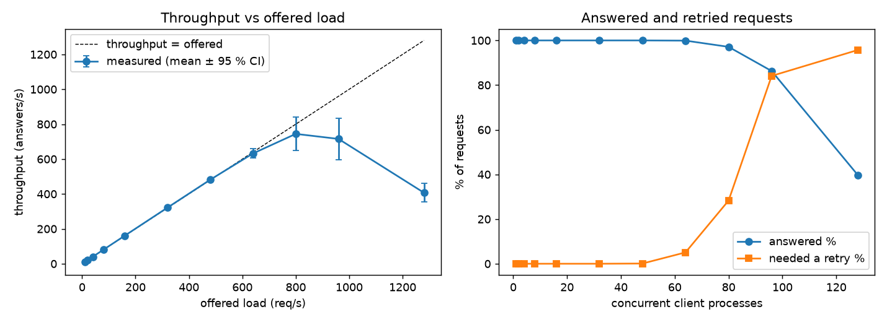
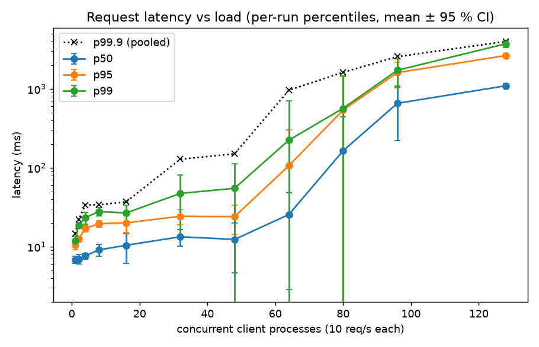
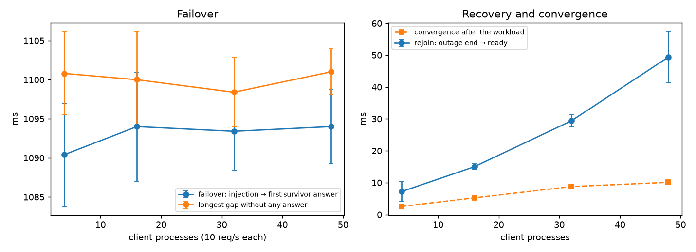
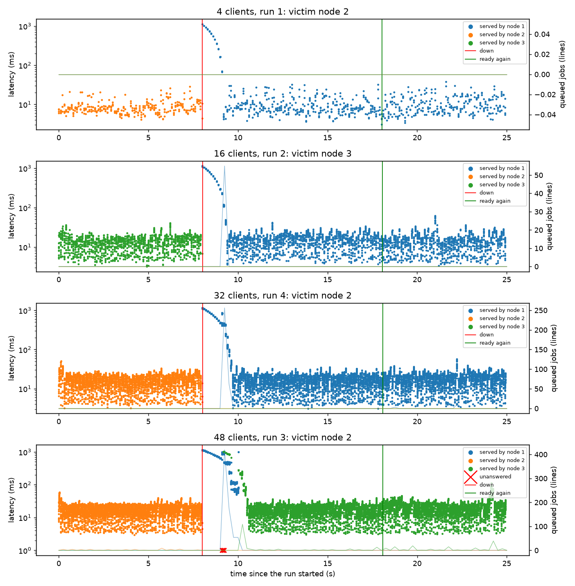

# Stress testing (Phase 1, bullet 6)

How the cloud behaves as the number of concurrent clients grows, with and without
an injected failure of the elected server: the harness, what each figure means,
the local results, and what they say about the design. Decisions behind the
method are in the [design log](design-log.md) (November 3).

## The harness

`target/release/stress` (source: `crates/client/src/bin/stress.rs`; metrics in
`client::stress`, statistics in `client::stats`, both unit-tested). One
invocation is one *sweep*: a list of load levels, each run `--reps` times.

- **A level** is a number of concurrent client *processes*. Each one is the
  normal `client` binary (own client id, own TCP connections to all three nodes,
  own retries), sending `--requests` incidents open loop at `--rate` per second.
  Offered load = processes × rate.
- **Run order:** rep 1 runs every level once in a shuffled order, then rep 2 in
  another order, and so on (seeded by `--seed`), so drift over a sweep (tables
  growing, thermal throttling) is spread over all levels instead of tracking load.
- **One run:**
  0. with `--before-run`: run that command (locally `scripts/run_local.sh`,
     which restarts all three nodes), wait until they are idle, send a 20-request
     warm-up that elects a server, and wait again. Every run then starts from
     empty tables, so runs are independent replications; without it, overloaded
     runs leave work behind that changes later runs ([Overload](#overload));
  1. wait until all nodes are `Ready` with nothing queued or running;
  2. full `Status` of every node (counters before);
  3. start the processes; a sampler polls every node with `Probe` every
     `--sample-ms` (250): phase, epoch, server, queue, running, load score, CPU,
     memory, table sizes;
  4. with `--fault-ms`: at `--fault-at-ms`, take down the server most nodes
     name for `--fault-ms`: send it `InjectFailure` (a mute: the spec's fault),
     or with `--fault-cmd` run a command that kills it and starts it again
     (`scripts/restart_node.sh {node} {ms}`: a crash and cold restart; the outage
     starts when it stops answering probes). Then poll it until it is `Ready`;
  5. wait for the processes to exit, then until every node is idle *and* the
     three results digests are equal: the **convergence time**;
  6. full `Status` again. Node counters in the results are after − before,
     summed over the three nodes.
- **Output** (in `--out`):

  | File | Contents |
  |---|---|
  | `summary.md` | the tables below, for one sweep |
  | `levels.csv` | one row per level: mean and 95 % CI half-width of every per-run figure, pooled percentiles |
  | `runs.csv` | one row per run: every figure defined below |
  | `requests.csv.gz` | every request: run, level, rep, process, seq, send time (ms since the run started), latency, serving node, epoch, attempts, Busy replies, answered |
  | `samples.csv` | every probe: run, time, node, phase, epoch, server, queue, running, pending cost, score, CPU, RSS, results |
  | `nodes.log.gz` | the nodes' logs over the sweep (`stress_local.sh`): one line per election, outage and recovery |
  | `meta.txt` | flags, machine, client config |

The `Probe` message exists for the sampler: `Status` serializes every retained
result to compute the digest while holding the node's state lock, which at
tens of thousands of results is a pause of several ms per poll in the middle of
the work being measured ([protocol](protocol.md#proberequest--probe-diagnostic-client--node)).

## Figures

Per run, from the processes' CSVs (`client::stress::run_metrics`):

| Figure | Definition |
|---|---|
| throughput | (n − 1) / (last answer − first answer), answers per second. n / span would overstate a 100-request run by 1 % |
| p50, p95, p99, max | nearest-rank percentiles of the answered requests' latency (first send → accepted answer, retries included) |
| answered, retried | requests answered within the client's 5 attempts; requests that needed more than one attempt |
| served | answers per serving node; `top_share` = the busiest node's share |
| max gap | the longest time between two consecutive answers, over all processes |
| failover | injection → first answer from a node other than the victim |
| out of service | injection → the victim answers a probe as `Ready` again |
| windows | requests by first-send time: *before* the injection, *during* (injection → victim `Ready`), *after* |

From the nodes (`Status` deltas and probes): elections (rise of the highest epoch),
`ElectBid` and `Replicate` frames and bytes, mean election duration (from the
nodes' election records), retry triggers suppressed by `min_tenure_ms`, jobs
dropped on step-down, late results, peer-queue drops, resource overcommits,
highest queue length, CPU, resident memory, recovery time (the victim's own
`last_recovery_ms`: end of the mute, or process start, → `Ready`).

Per level (`levels.csv`, `summary.md`): the mean of each per-run figure over the
level's runs ± the 95 % confidence half-width, t(n−1) · s / √n with s the
sample standard deviation over runs (`client::stats::ci95`). The runs, not the
requests, are the independent samples: requests in one run share the elected
server, its queue and the machine's state. Tail percentiles are also given
pooled over all requests of a level, since one run of 100 requests has no
meaningful p99.9.

## Running it

Locally (three nodes on 127.0.0.1, restarted before every run):

```bash
scripts/stress_local.sh [NAME]                     # ≈50 min; results/stress/NAME/{load,fault,restart}
python3 scripts/plot_stress.py results/stress/NAME # PNGs into results/stress/NAME/plots
```

A shorter check: `LOAD_CLIENTS=1,8 LOAD_REPS=2 FAULT_CLIENTS=8 FAULT_REPS=1
scripts/stress_local.sh quick`; `SWEEPS="fault restart"` runs a subset. In the
lab, run `stress` directly on a client machine against `config/client.toml`
([deployment](deployment.md), test 5), restarting all three nodes before each
sweep (or giving `--before-run` a command that does). On Windows the binary is
`target\release\stress.exe`; the flags are the same.

Flags: `--clients 1,2,4` levels, `--reps`, `--requests` and `--rate` per process,
`--complexity`, `--fault-ms`/`--fault-at-ms`, `--sample-ms`, `--pause-ms` between
runs (default 1000, lets the CPU average decay), `--client-threads` (Tokio workers
per process, default 2), `--settle-secs` (give up waiting for idle/recovery/
convergence), `--seed`, `--label`, `--before-run`, `--fault-cmd`, `--out`,
`--client-bin` (default: the `client` next to `stress`).

## Results (local)

One machine (Apple Silicon, 10 cores, macOS) ran the three nodes and every
client process, release build, complexity 5, `request_timeout_ms` 1000, 5
attempts, `min_tenure_ms` 1000, `bid_timeout_ms` 100. The load sweep ran on
commit 9eae4e9; the fault and restart sweeps on the commit that adds the peer
link reset (below), which the load sweep doesn't exercise. Data:
`results/stress/local-2026-11-03/{load,fault,restart}` (`summary.md` has every
column); plots: `results/stress/local-2026-11-03/plots/`.

### Load

55 runs: 11 levels × 5 reps, 100 requests per process at 10 req/s, 239 500
requests. Mean over runs ± 95 % CI; p99.9 pooled over the level's requests.

| clients | offered req/s | throughput req/s | answered % | p50 ms | p99 ms | pooled p99.9 ms | elections / run | retried % |
|---|---|---|---|---|---|---|---|---|
| 1 | 10 | 10.0 ± 0.0 | 100 | 6.8 ± 0.7 | 11.8 ± 1.7 | 14.7 | 0 | 0 |
| 2 | 20 | 20.1 ± 0.0 | 100 | 7.0 ± 1.0 | 18.7 ± 1.5 | 22.1 | 0 | 0 |
| 4 | 40 | 40.3 ± 0.0 | 100 | 7.6 ± 0.7 | 23.2 ± 4.0 | 33.6 | 0 | 0 |
| 8 | 80 | 80.6 ± 0.0 | 100 | 9.1 ± 1.5 | 27.9 ± 3.5 | 33.9 | 0 | 0 |
| 16 | 160 | 161 ± 0.1 | 100 | 10.4 ± 4.3 | 26.7 ± 6.5 | 36.9 | 0 | 0 |
| 32 | 320 | 322 ± 0.3 | 100 | 13.3 ± 3.2 | 47.2 ± 33 | 128 | 0 | 0 |
| 48 | 480 | 482 ± 0.7 | 100 | 12.3 ± 7.7 | 54.9 ± 58 | 150 | 0.2 | 0.1 |
| 64 | 640 | 632 ± 26 | 99.9 | 25.5 ± 23 | 224 ± 485 | 960 | 1.0 | 5.1 |
| 80 | 800 | 744 ± 97 | 97.1 | 164 ± 277 | 566 ± 896 | 1618 | 4.0 | 28 |
| 96 | 960 | 715 ± 120 | 86.3 | 655 ± 435 | 1720 ± 672 | 2557 | 11.2 | 84 |
| 128 | 1280 | 407 ± 54 | 39.7 | 1093 ± 69 | 3723 ± 378 | 3985 | 13.2 | 96 |




Also in `plots/`: the latency CDF per level (`load_latency_cdf.png`), elections,
`ElectBid` traffic, queue and CPU per level (`load_coordination.png`), and every
run's throughput and p99 (`load_runs_scatter.png`).

**Up to 48 processes (480 req/s): linear, and coordination costs nothing.**
Throughput matches the offered load within 1 %, every request is answered on
its first attempt, p50 grows from 7 to 13 ms and mean p99 stays under 60 ms (the
growth is queueing at the one server: its longest queue goes from 0 to 15 jobs).
After the warm-up's election there are no elections (one run of these 35 had
one), so no `ElectBid` frames: the on-demand election costs nothing while the
server keeps up. Replication is one `Replicate` per answer to each follower,
1.3–2.8 KB per answer, and the three results digests are equal 1–4 ms after the
last answer in every run. The wide p99 CI at 32 and 48 comes from individual runs
with a slow spike (pooled p99.9 128–150 ms).

**64–80 processes: the knee, and runs are bimodal.** One server on this
machine handles about 640–800 req/s at complexity 5 (it shares the 10 cores
with up to 80 client processes). At these levels a run either stays healthy or
collapses, with little in between:

| clients | healthy runs (0 elections) | collapsed runs |
|---|---|---|
| 64 | 4 of 5: 100 % answered, p99 44–57 ms | 1: 5 elections, 99.5 % answered, p99 923 ms |
| 80 | 3 of 5: 800 req/s, 100 % answered, p99 56–63 ms | 2: 10 elections, 93 % answered, p50 260–514 ms |
| 96 | 0 | 5: 11–12 elections, 73–92 % answered |
| 128 | 0 | 5: 13–14 elections, 38–44 % answered |

So the means and CIs at 64–80 summarize two different regimes; the per-run
values are in `runs.csv` and `load_runs_scatter.png`.

**96–128 processes: goodput collapses.** Throughput falls below what the cluster
served at 80 processes (715 and 407 req/s against 744), 84–96 % of requests
need a retry, and at 128 only 40 % are answered within 5 attempts. The next
section explains why.

### Overload

Every collapsed run shows the same cycle, with about one election per second
of the run (`min_tenure_ms` is the only brake):

1. The server's queue grows until one request takes longer than
   `request_timeout_ms` (1 s). Its client resends it, and a retry reaching a
   follower after the server's `min_tenure_ms` triggers an election: the design
   uses retries as its failure detector, and a slow server looks like a failed one.
2. The old server steps down and **drops its queued jobs** (`dropped_on_step_down`:
   600–5 200 per run at 80–96 processes, 19 000–23 500 at 128). Work that
   requests have already waited for is thrown away.
3. The new server **takes over every not-completed request** in its table, oldest
   first, including the ones whose clients already timed out and resent them. It
   starts with a backlog older than the timeout, so its answers come late too,
   more requests time out, and the next retry after `min_tenure_ms` elects again.

It is metastable: one late request is enough to start the cycle, and the cycle
keeps itself going for as long as the load stays high, which is why the same
80-process load is either served at p99 ≈ 60 ms or not.

**It also outlives the run.** The first version of the harness didn't restart
the cluster between runs (`results/stress/local-2026-11-03/no-restart/`: 27 runs
before it aborted, build 91557e6). Requests abandoned in an overloaded run stay
pending in every node's table until the 30-minute TTL, and every later election
takes them over again: 48 processes went from 100 % answered on a fresh cluster to
41–42 % after earlier overloaded runs, 64 from 100 % (run 1) to 23 % (run 24),
and even 16 and 32 processes needed elections. The node logs and per-run counters
are kept there. That is why every run now starts from a restarted cluster.

**Open question.** While draining a takeover backlog in that no-restart sweep,
the serving node completed only about 100 jobs/s on 1–3 cores: each job cost
about 6 times what it costs on a fresh cluster, with the time in the planner's
Dijkstra. Lock contention on the planner (273 replans) doesn't explain it. We
have not established why a job is that much more expensive there.

### Failures under load

Two sweeps of 20 runs (4 levels × 5 reps, 250 requests per process at 10 req/s,
125 000 requests each). In every run the elected server goes down at 8 s for
10 s: **mute** (`InjectFailure`, the process keeps its memory) or **restart**
(`kill -9`, started again 10 s later, empty memory, cold rejoin).

| clients | outage | failover ms | longest gap ms | recovery ms | out of service ms | p99 during / after ms | elections / run | unanswered | converged |
|---|---|---|---|---|---|---|---|---|---|
| 4 | mute | 1110 ± 1 | 1197 ± 6 | 8.8 ± 2.7 | 10025 ± 2 | 1036 / 27 | 1.0 | 0 | 5/5 |
| 4 | restart | 1090 ± 7 | 1101 ± 5 | 7.2 ± 3.2 | 10033 ± 17 | 937 / 28 | 1.0 | 0 | 5/5 |
| 16 | mute | 1114 ± 8 | 1188 ± 8 | 26.0 ± 2.5 | 10035 ± 13 | 1062 / 33 | 1.0 | 0 | 5/5 |
| 16 | restart | 1094 ± 7 | 1100 ± 6 | 15.0 ± 0.9 | 10037 ± 12 | 980 / 35 | 1.0 | 0 | 5/5 |
| 32 | mute | 1114 ± 4 | 1173 ± 3 | 36.6 ± 5.2 | 10045 ± 3 | 1097 / 35 | 1.2 | 0 | 5/5 |
| 32 | restart | 1093 ± 5 | 1098 ± 4 | 29.4 ± 1.9 | 10048 ± 3 | 1041 / 35 | 1.4 | 0 | 5/5 |
| 48 | mute | 1110 ± 2 | 1155 ± 3 | 52.2 ± 4.6 | 10063 ± 11 | 1112 / 83 | 2.6 | 59 | 5/5 |
| 48 | restart | 1094 ± 5 | 1101 ± 3 | 49.4 ± 8.0 | 10070 ± 3 | 1096 / 41 | 2.0 | 37 | 5/5 |




The same figures for the mute sweep are `fault_summary.png` and
`fault_timeline.png`, and p99 by window is in `{fault,restart}_windows.png`.

- **Failover takes 1.1 s at every load**, with a CI of a few ms. It is
  detection, not election: the client's `request_timeout_ms` (1000) before its
  retry reaches a survivor, then about 100 ms of election (the down node's bid
  never comes, so the 2-of-3 rule waits out `bid_timeout_ms`), then the answer.
  The longest gap without any answer is the same 1.1–1.2 s. The restart sweep's
  ~20 ms lower failover is a measurement offset: its injection is timestamped
  when the victim stops answering probes, a little after the kill.
- **Clients see one timeout and nothing else.** Requests in flight at the outage,
  or sent during detection, take about 1 s (p99 during the outage ≈ 1 s); requests
  sent after the victim is back are as fast as before (p99 27–41 ms; 83 ms for
  mute at 48). Throughput over the run equals the offered load.
- **Recovery takes 7–52 ms** and grows with the state it copies (about 740
  results at 4 processes, 8 700 at 48): one snapshot per peer, merged,
  ledger rebuilt. A cold restart (copy everything into empty tables) costs about
  the same as a mute (merge into what the node already had). Time out of service
  is the 10 s outage plus 25–70 ms: process start or end of mute, probe, recovery.
- **Every run converged**, 2.5–10 ms after the last answer. Before the peer link
  reset, the restart sweep at 48 processes converged in 0 of 5 runs: each
  survivor dropped 360–390 frames meant for the rejoined node in the 1–2 s
  after it took its snapshot, while its link was still backing off behind a
  stale backlog of about 4000 frames
  (`results/stress/local-2026-11-03/before-link-reset/`, design log November 3).
- **A second election at 48 processes.** The new server takes over everything
  sent during the 1.1 s of detection (about 430 queued jobs), answers new
  requests Busy until it catches up, and a retry after its `min_tenure_ms`
  elects again (2.0–2.6 elections per run). It is the overload cycle in
  miniature, and it dies out because the load is below capacity.
- **0.06–0.1 % unanswered at 48 processes** (37–59 of 60 000 requests), all
  sent in the 150 ms right after failover, all with 4–5 Busy replies: the
  client's Busy backoff (50 ms doubling, about 0.75 s over 5 attempts) runs
  out before the takeover backlog drains. Up to 32 processes nothing is lost.

Two caveats specific to the restart sweep. Its node counters (frames, bytes,
step-downs) leave the victim out: its counters restart from zero with the
process, and the harness's after − before delta is clamped at zero, which is why
its `Replicate` bytes per answer are half the mute sweep's. And its p99
*before* the outage in `summary.md` (681 and 908 ms at 16 and 32 processes)
counts the requests in flight at the kill, sent 2–21 ms before it was detected;
the processes send on near-synchronised 100 ms grids, so at 16–32 processes one
such burst is more than 1 % of the window.

### What it says about the design

- **One elected server sets the capacity**: about 640–800 req/s at complexity 5
  here. The other two nodes add availability, not throughput. In steady state
  the only coordination is one `Replicate` per answer to each follower; the
  on-demand election costs nothing while the server keeps up.
- **The client timeout is both the failure detector and the overload trigger.**
  Failover is `request_timeout_ms` + ~100 ms, so a shorter timeout fails over
  faster. But every retry after `min_tenure_ms` can start an election, and the
  pooled p99.9 is already 128–150 ms at 32–48 processes. The config comment's
  "about 2× the measured p99" (≈ 100 ms) would put normal tail requests past the
  timeout and start the overload cycle at much lower load. Until elections are
  gated on liveness (below), keep the timeout well above the p99.9 at the
  planned load: 1 s is about 7× it here.
- **`min_tenure_ms` limits the damage but doesn't stop the cycle**: it caps
  elections at about one per second, which is the rate every collapsed run shows.
- **Recovery is cheap**, and a mute and a crash behave the same for clients:
  the survivors serve throughout, and the rejoining node takes no client work
  until it is current.

### Limitations

- **One machine.** Nodes, harness and up to 128 client processes share 10 cores
  and the loopback interface, so there is no network delay, and the knee is
  where the machine saturates, not one node; the client processes compete
  with the server for CPU. The lab numbers have to be measured on the six
  machines ([deployment](deployment.md), test 5).
- **Arrivals are bursty.** The processes start together and each sends every
  100 ms, so arrivals come in near-synchronised bursts rather than as a Poisson
  stream; queueing at high process counts is likely worse than with independent users.
- **Five runs per level.** At bimodal levels (64–80) a mean ± t-interval
  describes neither regime; use the per-run values.
- Fixed complexity 5; one outage time and length (10 s at 8 s).

### Follow-ups (not done here: design changes for the team)

1. **Bound takeovers**: skip requests older than the clients' give-up horizon
   (`request_timeout_ms` × attempts ≈ 5 s), so a new server doesn't start
   with work nobody is waiting for.
2. **Gate election triggers on liveness**: a follower that got a `Replicate`
   from the server within the last timeout knows it is alive and slow, and can
   answer Busy instead of starting an election.
3. **Keep the queue on step-down** (hand it over, or let the old server finish
   it) instead of dropping it.
4. **Admission control**: answer Busy when the expected wait exceeds the client
   timeout, so clients back off before they time out.
5. **Busy budget**: enough attempts or backoff to outlast a takeover backlog
   (the 0.06–0.1 % lost at 48 processes).
6. **Harness**: count a restarted node's counters from its restart.
7. Run the same sweeps with the per-request election mode for comparison.
