# Six-PC election comparison

2 completed runs.

| Stage / scenario | Mode | Processes/PC | Rate/process | Runs valid / total | Success % | p50 / p95 / p99 ms | Mean within-run latency SD ms | Goodput mean ± SD | Converged |
|---|---|---|---|---|---|---|---|---|---|
| normal/normal | on_demand | 1 | 30 | 1/1 | 100.00 | 4.65 / 6.66 / 7.80 | 1.63 | 90.00 ± N/A | 1/1 |
| normal/normal | per_request | 1 | 30 | 1/1 | 100.00 | 5.56 / 7.17 / 7.69 | 1.91 | 90.00 ± N/A | 1/1 |

## Validity and resource diagnostics

| Scenario | Mode | Processes/PC | Rate | Generator-invalid runs | Invalid interventions | Mean peer drops | Mean overcommit detections | Mean resource conflicts | Missing rows |
|---|---|---|---|---|---|---|---|---|---|
| normal | on_demand | 1 | 30.0 | 0 | 0 | 0.00 | 0.00 | 0.00 | 0 |
| normal | per_request | 1 | 30.0 | 0 | 0 | 0.00 | 0.00 | 0.00 | 0 |

## Measurement definitions

- Rates are per process; processes are per client PC. Total offered load = 3 × processes/PC × rate/process.
- Latency describes successful requests. Failed and missing requests remain in the availability denominator; failed elapsed times are recorded separately.
- lat_sd_ms is sample SD within a run (n−1). Summary SD/CI describe independent repetitions; p50/p95/p99 means are means of run percentiles, not pooled percentiles. Fewer than two observations/runs gives N/A for SD/CI.
- Percentiles use the nearest sorted index round((n−1)×p), matching the existing Rust client. CDF figures use histogram bins; exact run percentiles are in runs.csv.
- CI uses conservative two-sided Student-t 95% intervals. Shared machines/network still limit generalization beyond this experiment.
- A measurement-invalid run is retained and shown. Generator-invalid means missing scheduled sends, <95% dispatched within the workload window, or dispatch p95 >100 ms. Inspect achieved_send_rps before interpreting server capacity.
- Paired differences use only measurement-valid pairs with the same condition, seed and repetition. Positive differences mean per_request minus on_demand.
- Every independent run restarts all servers and requires an empty healthy baseline, then converged warm-up. Nonconvergent runs remain failures; the next run must establish a fresh baseline.
- Soak observations are continuous operation and are analyzed separately. A common sustainable normal point is required before soak execution.
- Election decisions/durations are summed across node decisions, not unique logical elections. Per-request elections do not change the persistent-server epoch.
- Fault target is the incumbent in on_demand, or the most active measured worker in per_request. First-survivor latency requires a request submitted after acknowledged injection and computed by a non-victim.
- Recovery time excludes the requested mute interval and includes polling uncertainty. Convergence time is an observed upper bound after client completion; collection overlaps provisional convergence polling.
- Wall-clock alignment uses measured agent offsets. Inspect uncertainty and offset drift before interpreting cross-PC intervention windows; request latency and dispatch lag use monotonic clocks.
- Repair lag uses the latest peer revision observed, so zero known lag while disconnected does not prove convergence. Host network counters can include both virtual and physical interfaces.
- Server logging defaults to warn in both modes to avoid per-request election log I/O dominating the comparison. Node counters, full snapshots, warnings and raw samples are retained.

## Figures

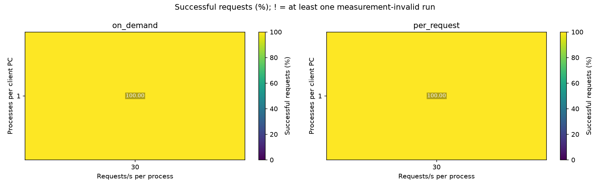
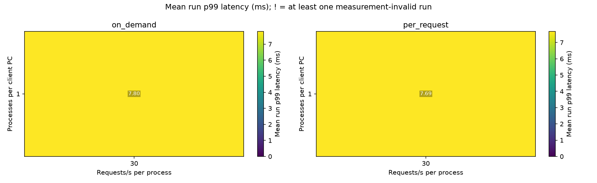
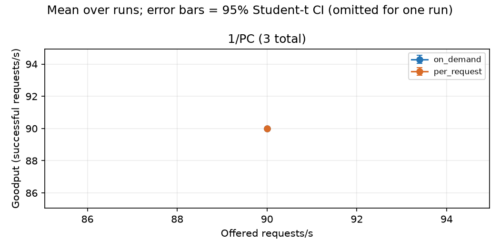
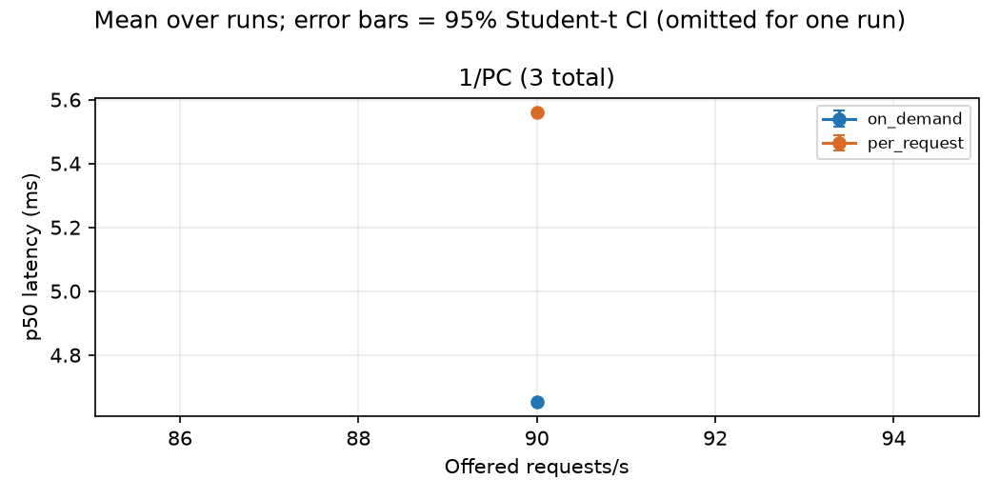
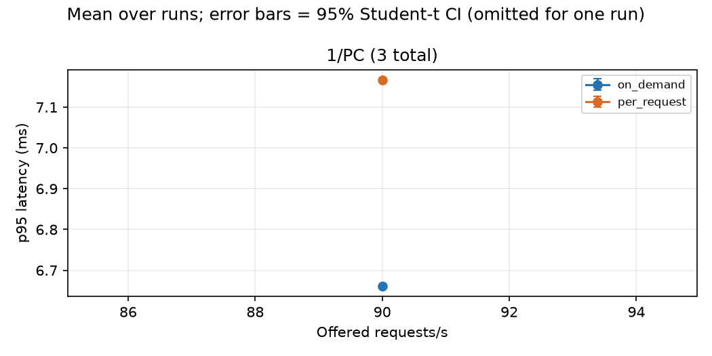
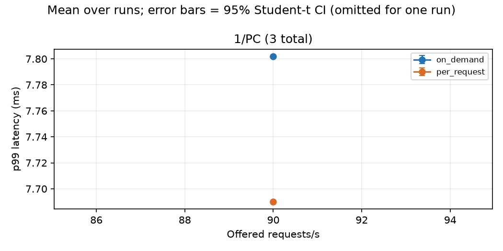
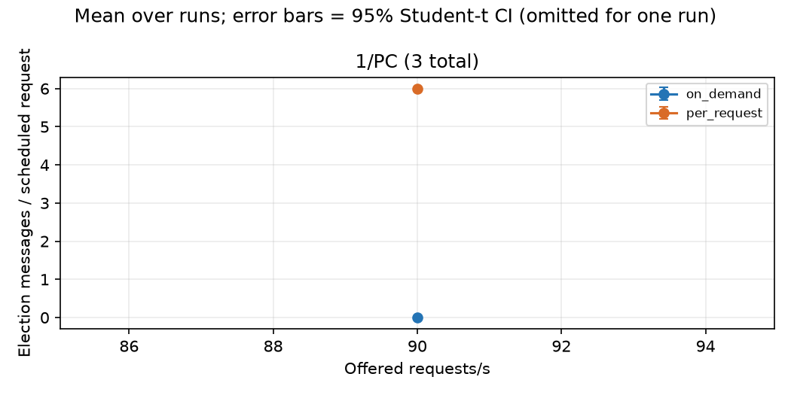
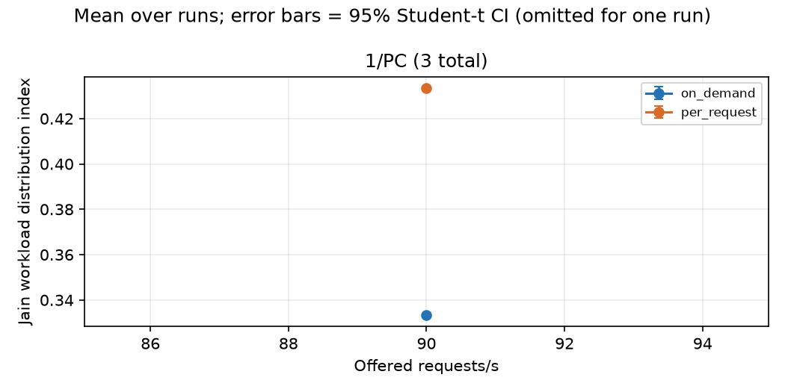
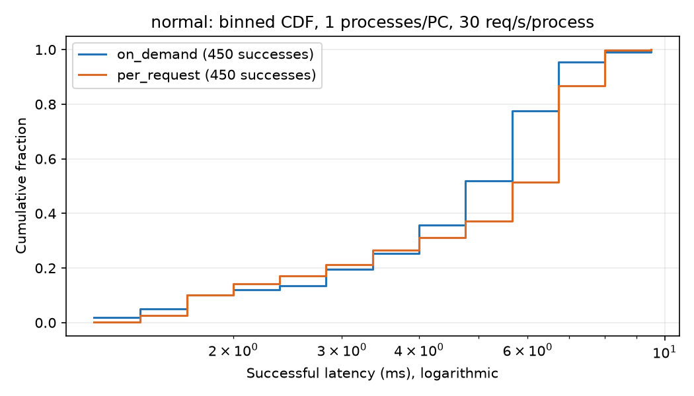
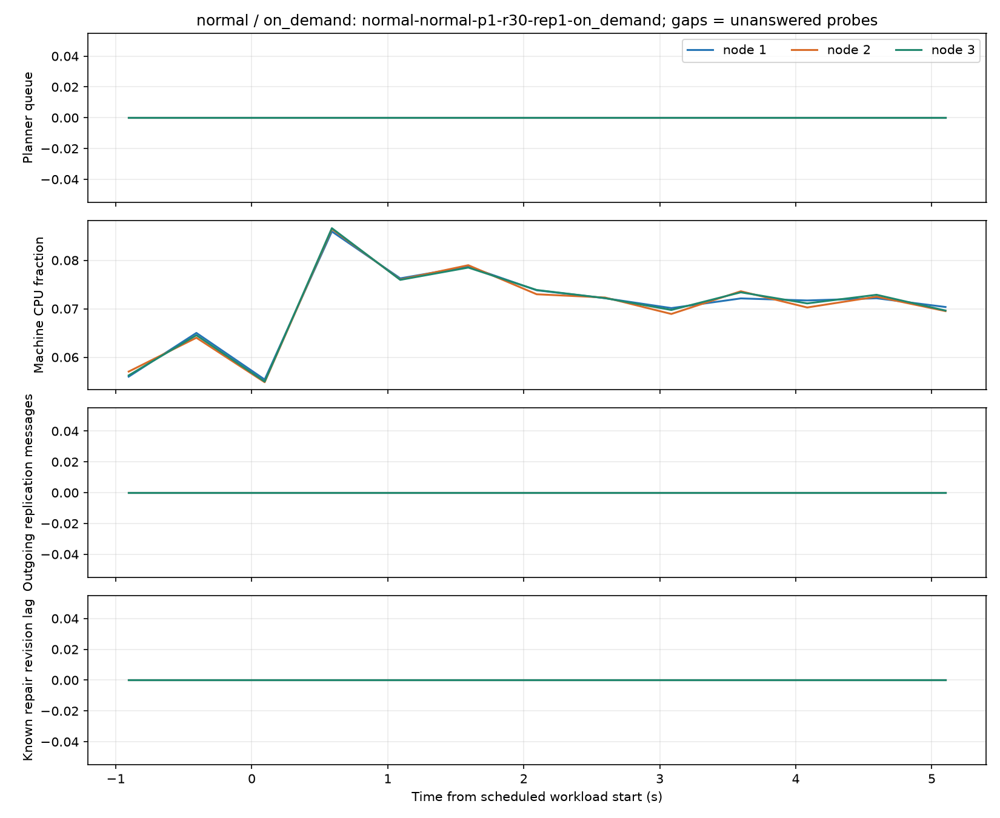
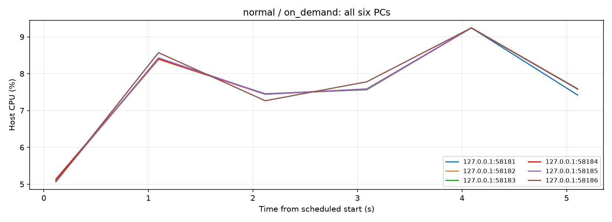
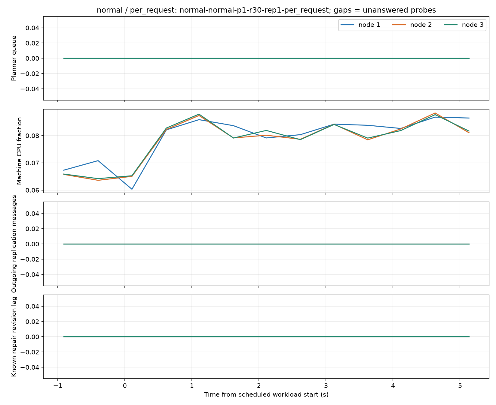
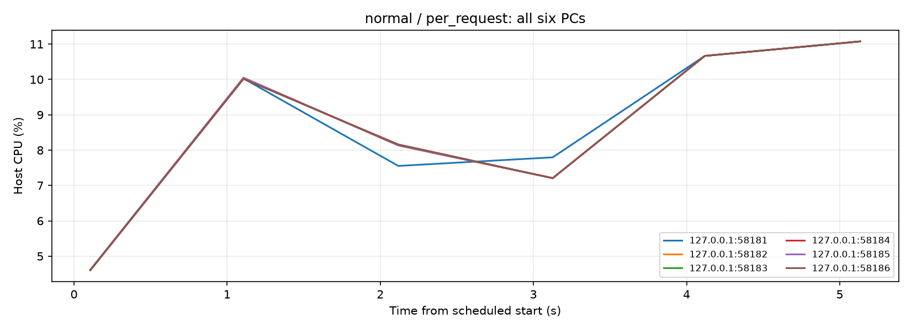
