# Phase 1 UDP reliability report

| Scenario | Clients | Runs | Requests | Success % [Wilson 95%] | p50 / p95 / p99 ms | Goodput ± CI | Converged | Baseline verified / failed / unknown | Faults injected/requested | Missing | Exit failures | Peer drops / overcommits |
|---|---|---|---|---|---|---|---|---|---|---|---|---|
| faulty | 4 | 2 | 1440 | 100.00 [99.73, 100.00] | 5.75 / 1009.50 / 1092.82 | 114.12 ± 0.32 | 2/2 | 2 / 0 / 0 | 2/2 | 0 | 0 | 0 / 0 |
| faulty | 16 | 2 | 5760 | 100.00 [99.93, 100.00] | 9.86 / 1126.52 / 1293.46 | 398.15 ± 2.15 | 2/2 | 2 / 0 / 0 | 2/2 | 0 | 0 | 0 / 0 |
| imbalance | 4 | 2 | 1440 | 100.00 [99.73, 100.00] | 5.20 / 8.06 / 11.22 | 113.57 ± 0.20 | 2/2 | 2 / 0 / 0 | 0/0 | 0 | 0 | 0 / 0 |
| imbalance | 16 | 2 | 5760 | 100.00 [99.93, 100.00] | 7.30 / 13.21 / 15.59 | 388.84 ± 21.46 | 2/2 | 2 / 0 / 0 | 0/0 | 0 | 0 | 0 / 0 |
| normal | 4 | 2 | 1440 | 100.00 [99.73, 100.00] | 5.26 / 7.49 / 10.40 | 114.23 ± 2.20 | 2/2 | 2 / 0 / 0 | 0/0 | 0 | 0 | 0 / 0 |
| normal | 16 | 2 | 5760 | 100.00 [99.93, 100.00] | 6.31 / 12.50 / 14.56 | 398.22 ± 1.81 | 2/2 | 2 / 0 / 0 | 0/0 | 0 | 0 | 0 / 0 |

## Load and transport diagnostics

| Scenario | Clients | Retried requests | Busy replies | Peak queue | UDP retransmissions | UDP delivery timeouts | Peak node RSS MiB | Control / replication drops | Repaired results | Expired jobs | Worker queue wait ms | Failed elapsed p95 ms |
|---|---|---|---|---|---|---|---|---|---|---|---|---|
| faulty | 4 | 174 | 3 | 0 | 65 | 0 | 30.07 | 0 / 0 | 481 | 0 | 4.38 | N/A |
| faulty | 16 | 1548 | 686 | 64 | 536 | 0 | 33.30 | 0 / 0 | 2183 | 0 | 24.44 | N/A |
| imbalance | 4 | 0 | 0 | 0 | 0 | 0 | 29.74 | 0 / 0 | 0 | 0 | 0.02 | N/A |
| imbalance | 16 | 0 | 0 | 5 | 0 | 0 | 33.37 | 0 / 0 | 4 | 0 | 2.20 | N/A |
| normal | 4 | 0 | 0 | 0 | 0 | 0 | 30.55 | 0 / 0 | 1 | 0 | 0.04 | N/A |
| normal | 16 | 0 | 0 | 6 | 0 | 0 | 32.97 | 0 / 0 | 3 | 0 | 2.15 | N/A |

## Interpretation

- Latency distributions include successful replies only; failed and missing operations remain in the success-rate denominator.
- Goodput includes process startup, retries and waiting for failures to exhaust. The older throughput_rps column measures the spacing between successful replies.
- 95% Student-t intervals describe variation across repeated runs. N/A means fewer than two runs. Fresh local clusters isolate repetitions; remote clusters retain history unless explicitly restarted.
- Wilson intervals are an approximate binomial reference; requests share servers and are correlated, so they do not establish real-world reliability. Zero observed failures is not proof of zero failure probability.
- A requested fault without a recorded victim is an invalid fault experiment. Inspect client exit failures, missing records, peer queue drops, resource overcommits and convergence failures.
- Protocol 2 convergence compares the current run client UUIDs after processing is idle, including at least every answered result. Legacy runs compare whole retained tables. See convergence_scope in reliability.csv.
- A verified baseline requires matching retention-safe digests and role views. Baseline unknown means legacy data; a failed baseline indicates explicit soak mode. Shared remote history still prevents claiming fresh independent repetitions.
- Protocol 2 writes baseline/final node JSON, preserves failed-request elapsed times and client UUIDs, and records split control/replication drops, repairs and worker queue waits. Repairs and drops are per-node counters rather than counts of unique incidents.
- Repair lag compares installed cursors with the last revisions observed from peers; it cannot reveal updates created while a peer is unreachable. Zero known lag alone does not establish convergence.
- Node counters are process-wide and include diagnostics/ACKs. Retransmissions indicate missing acknowledgements, which may be caused by data loss, ACK loss or delayed processing.
- These are measurements of the named machines, workload and network only. Multi-PC tests should use synchronized clocks; client latency itself uses a monotonic clock.

## Figures

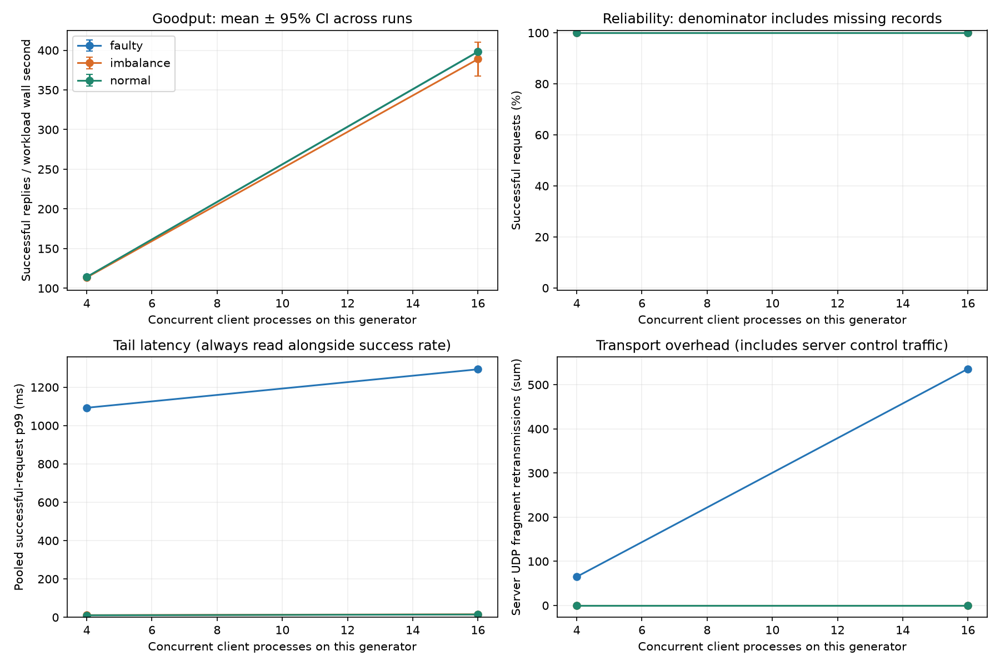
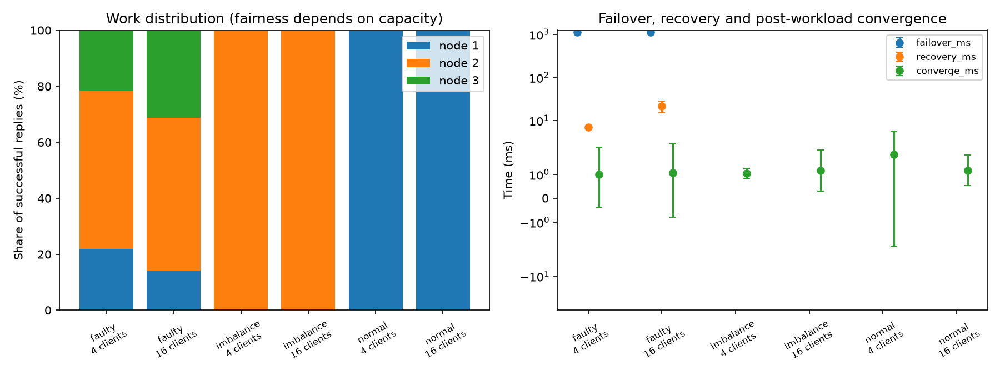
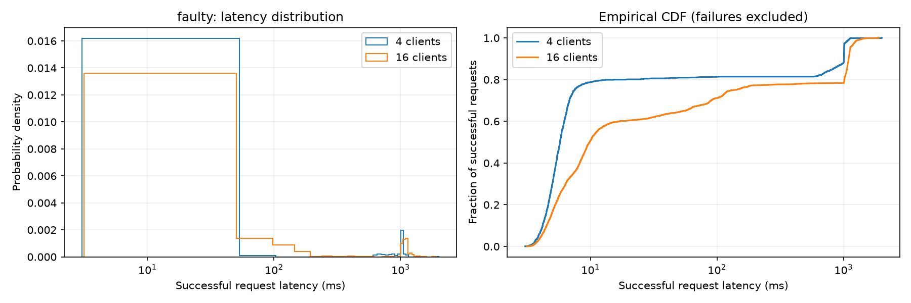
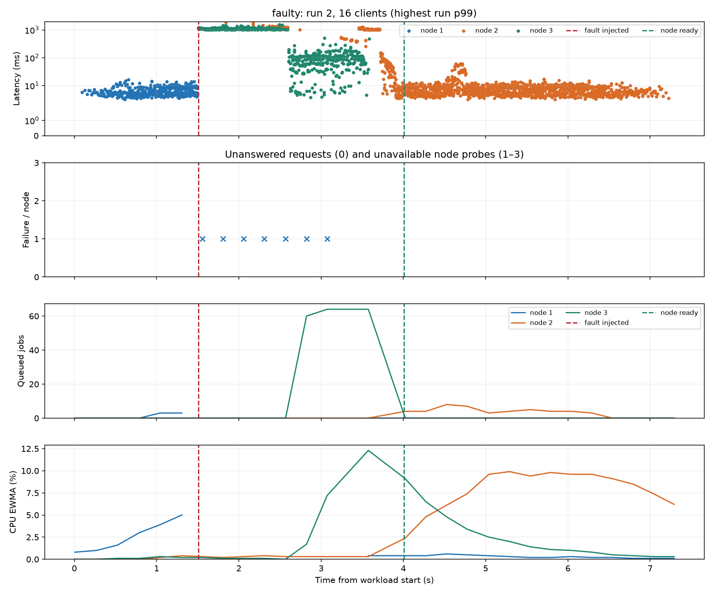
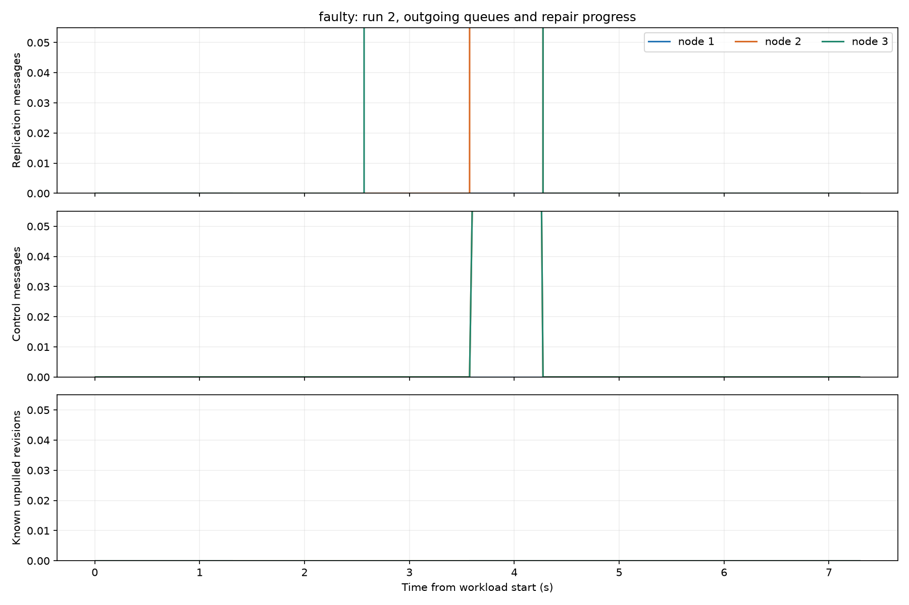
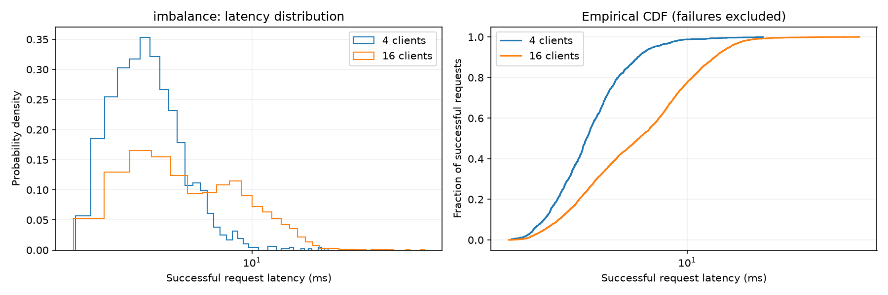
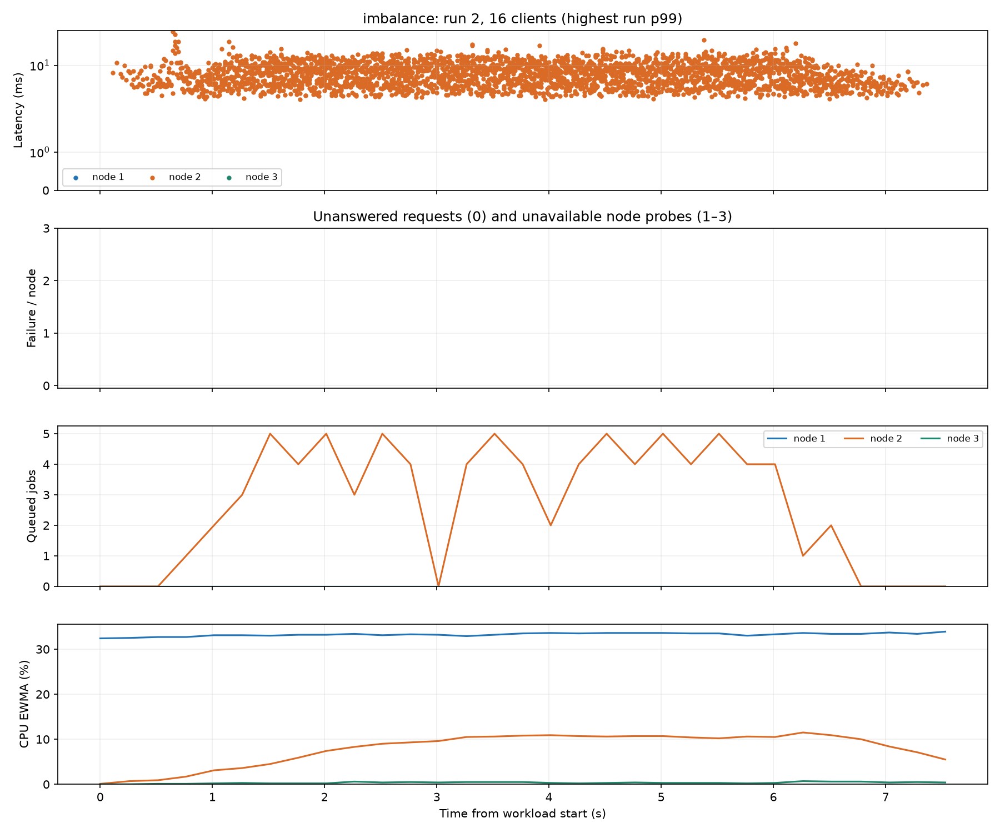
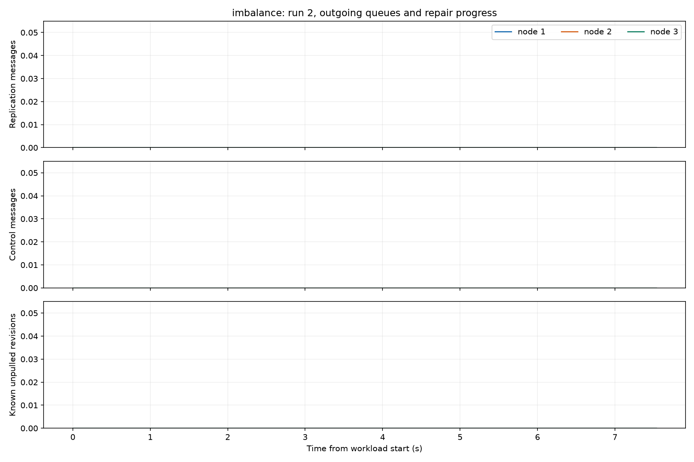
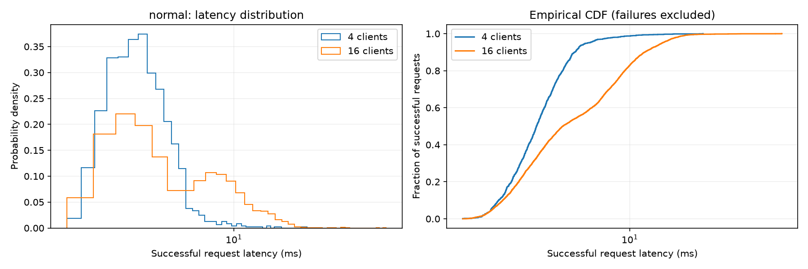
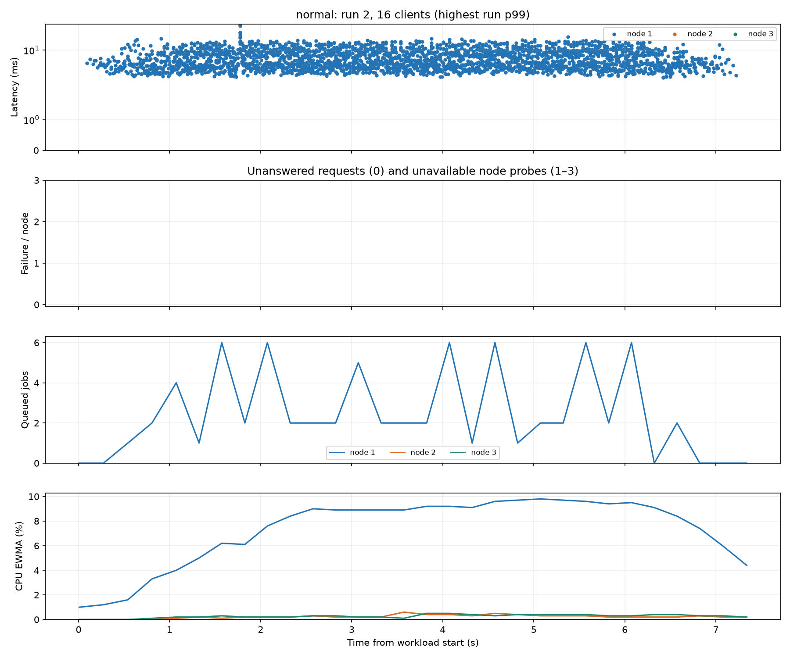
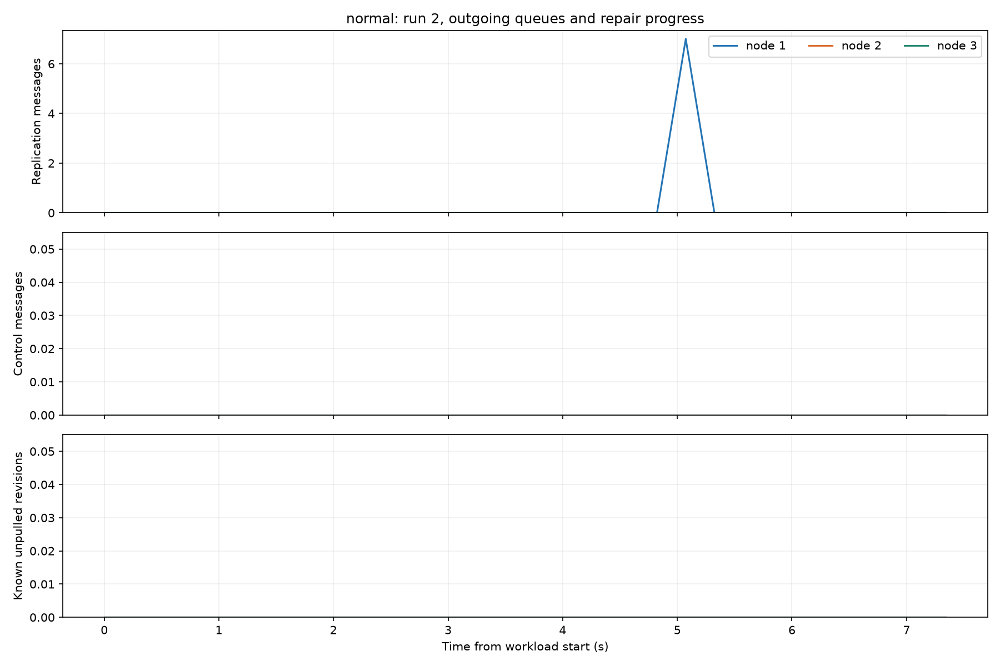
