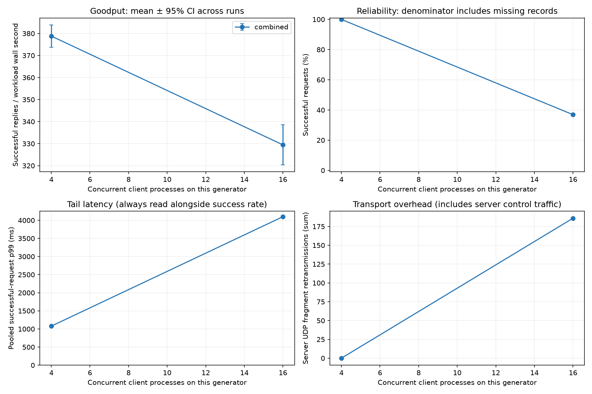
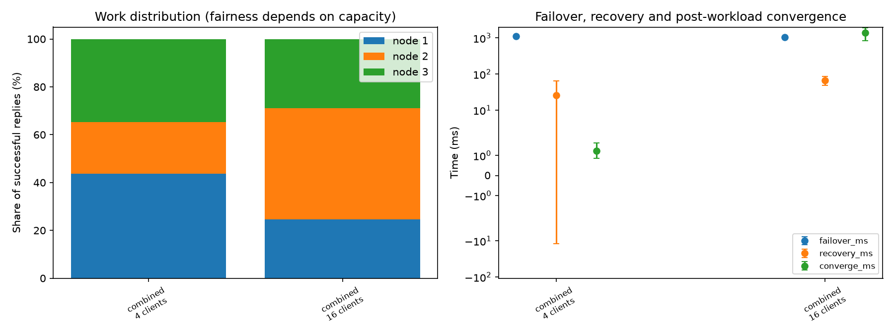
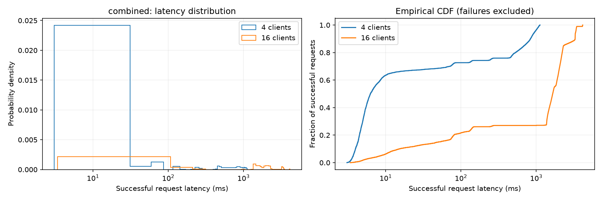
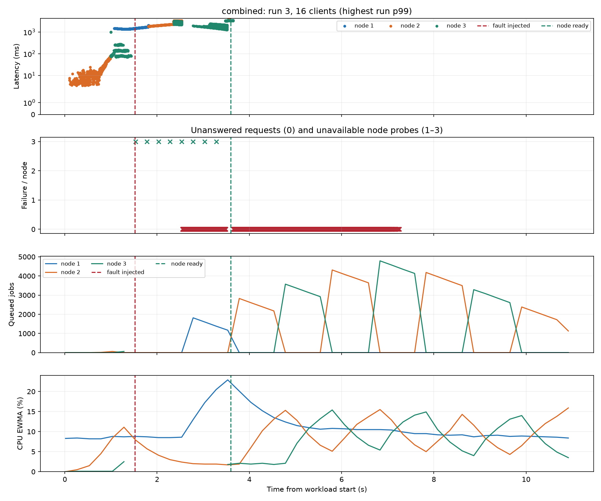

# Phase 1 UDP reliability report

| Scenario | Clients | Runs | Requests | Success % [Wilson 95%] | p50 / p95 / p99 ms | Goodput ± CI | Converged | Faults injected/requested | Missing | Exit failures | Peer drops / overcommits |
|---|---|---|---|---|---|---|---|---|---|---|---|
| combined | 4 | 2 | 4800 | 100.00 [99.92, 100.00] | 6.26 / 954.47 / 1079.01 | 378.81 ± 5.08 | 2/2 | 2/2 | 0 | 0 | 0 / 0 |
| combined | 16 | 2 | 19200 | 36.90 [36.22, 37.59] | 1652.38 / 3344.48 / 4100.26 | 329.44 ± 9.08 | 2/2 | 2/2 | 0 | 0 | 0 / 0 |

## Load and transport diagnostics

| Scenario | Clients | Retried requests | Busy replies | Peak queue | UDP retransmissions | UDP delivery timeouts | Peak node RSS MiB |
|---|---|---|---|---|---|---|---|
| combined | 4 | 591 | 1109 | 324 | 0 | 0 | 30.94 |
| combined | 16 | 17624 | 47556 | 4819 | 186 | 32 | 37.47 |

## Interpretation

- Latency distributions include successful replies only; failed and missing operations remain in the success-rate denominator.
- Goodput includes process startup, retries and waiting for failures to exhaust. The older throughput_rps column measures the spacing between successful replies.
- 95% Student-t intervals describe variation across repeated runs. N/A means fewer than two runs. Fresh local clusters isolate repetitions; remote clusters retain history unless explicitly restarted.
- Wilson intervals are an approximate binomial reference; requests share servers and are correlated, so they do not establish real-world reliability. Zero observed failures is not proof of zero failure probability.
- A requested fault without a recorded victim is an invalid fault experiment. Inspect client exit failures, missing records, peer queue drops, resource overcommits and convergence failures.
- Convergence means equal retained result counts/digests after processing becomes idle. It is separate from client success and from the returning node becoming Ready.
- Node counters are process-wide and include diagnostics/ACKs. Retransmissions indicate missing acknowledgements, which may be caused by data loss, ACK loss or delayed processing.
- These are measurements of the named machines, workload and network only. Multi-PC tests should use synchronized clocks; client latency itself uses a monotonic clock.

## Figures

