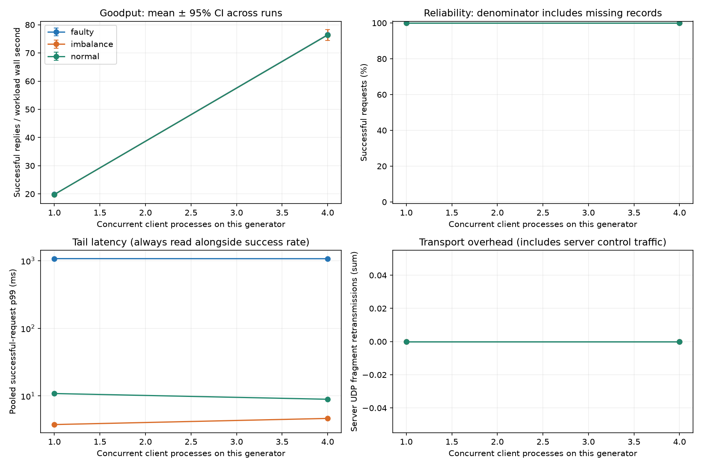
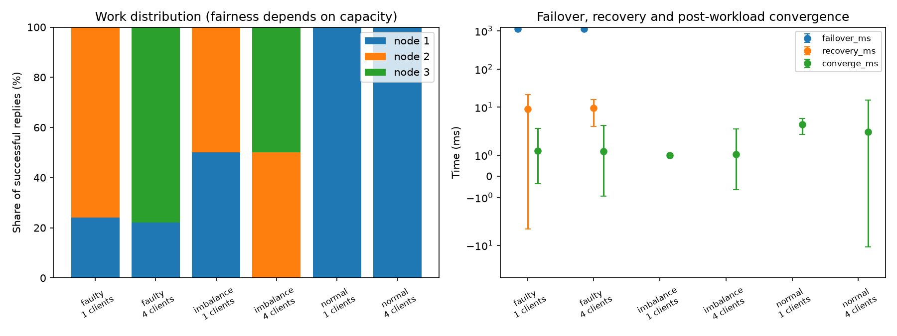
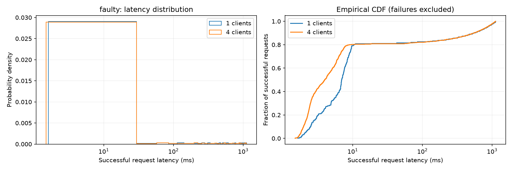
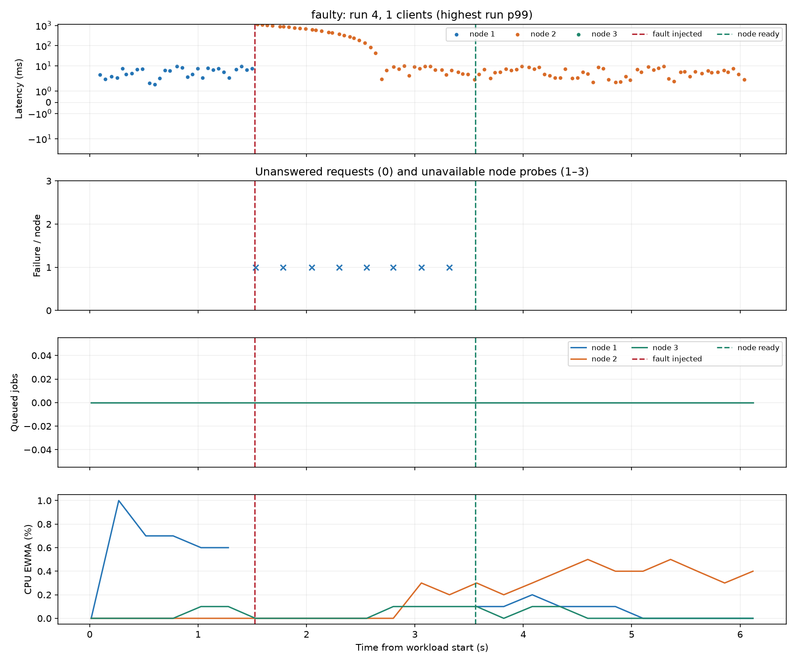
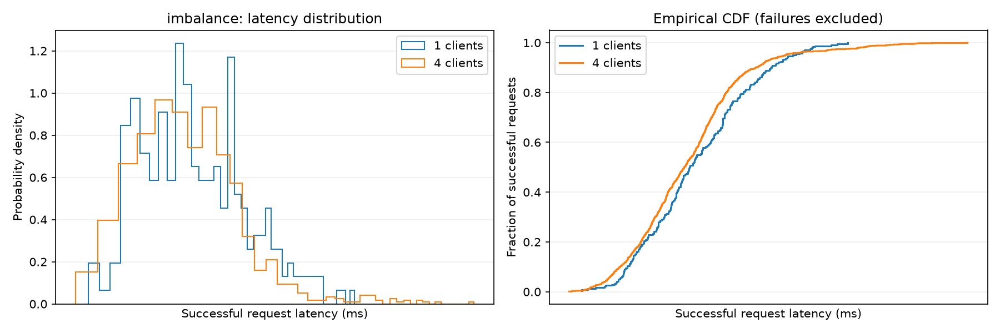
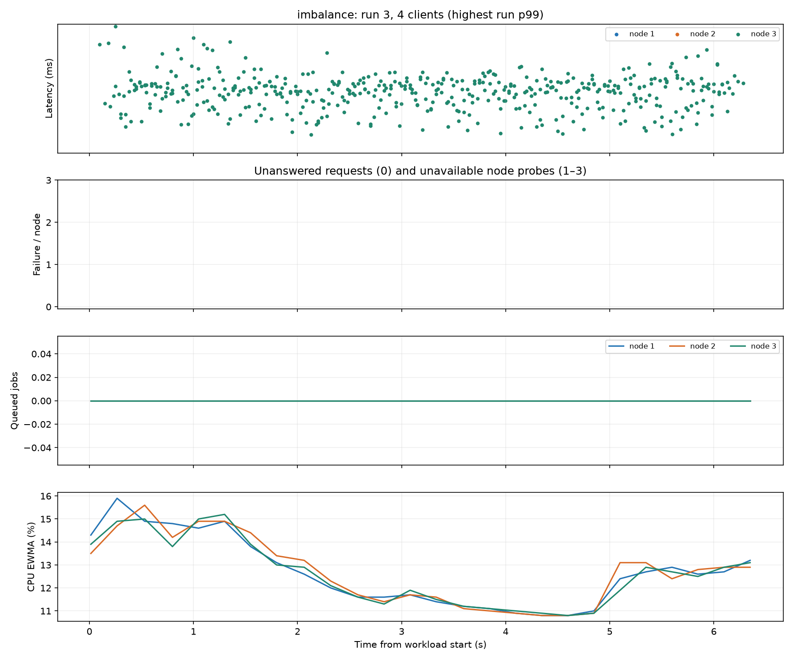
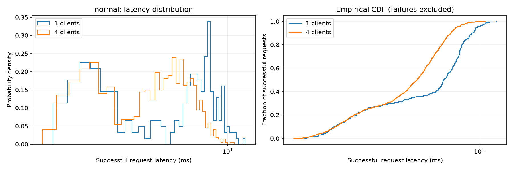
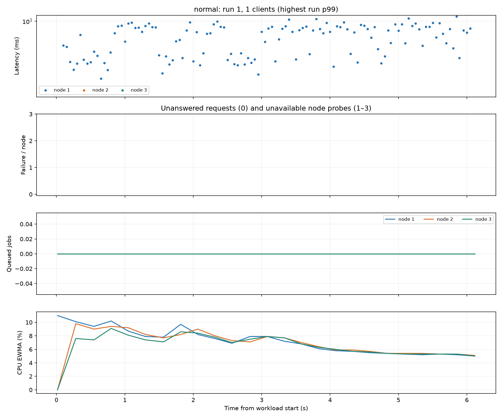

# Phase 1 UDP reliability report

| Scenario | Clients | Runs | Requests | Success % [Wilson 95%] | p50 / p95 / p99 ms | Goodput ± CI | Converged | Faults injected/requested | Missing | Exit failures | Peer drops / overcommits |
|---|---|---|---|---|---|---|---|---|---|---|---|
| faulty | 1 | 2 | 240 | 100.00 [98.42, 100.00] | 6.94 / 829.20 / 1074.60 | 19.83 ± 0.34 | 2/2 | 2/2 | 0 | 0 | 0 / 0 |
| faulty | 4 | 2 | 960 | 100.00 [99.60, 100.00] | 3.97 / 831.88 / 1071.49 | 76.47 ± 0.27 | 2/2 | 2/2 | 0 | 0 | 0 / 0 |
| imbalance | 1 | 2 | 240 | 100.00 [98.42, 100.00] | 2.21 / 3.27 / 3.78 | 19.79 ± 0.34 | 2/2 | 0/0 | 0 | 0 | 0 / 0 |
| imbalance | 4 | 2 | 960 | 100.00 [99.60, 100.00] | 2.16 / 3.18 / 4.65 | 76.40 ± 1.92 | 2/2 | 0/0 | 0 | 0 | 0 / 0 |
| normal | 1 | 2 | 240 | 100.00 [98.42, 100.00] | 6.93 / 9.78 / 10.86 | 19.80 ± 0.08 | 2/2 | 0/0 | 0 | 0 | 0 / 0 |
| normal | 4 | 2 | 960 | 100.00 [99.60, 100.00] | 5.25 / 7.94 / 8.94 | 76.38 ± 0.55 | 2/2 | 0/0 | 0 | 0 | 0 / 0 |

## Interpretation

- Latency distributions include successful replies only; failed and missing operations remain in the success-rate denominator.
- Goodput includes process startup, retries and waiting for failures to exhaust. The older throughput_rps column measures the spacing between successful replies.
- 95% Student-t intervals describe variation across repeated runs. N/A means fewer than two runs. Fresh local clusters isolate repetitions; remote clusters retain history unless explicitly restarted.
- Wilson intervals are an approximate binomial reference; requests share servers and are correlated, so they do not establish real-world reliability. Zero observed failures is not proof of zero failure probability.
- A requested fault without a recorded victim is an invalid fault experiment. Inspect client exit failures, missing records, peer queue drops, resource overcommits and convergence failures.
- Convergence means equal retained result counts/digests after processing becomes idle. It is separate from client success and from the returning node becoming Ready.
- Node counters are process-wide and include diagnostics/ACKs. Retransmissions indicate missing acknowledgements, which may be caused by data loss, ACK loss or delayed processing.
- These are measurements of the named machines, workload and network only. Multi-PC tests should use synchronized clocks; client latency itself uses a monotonic clock.

## Figures

