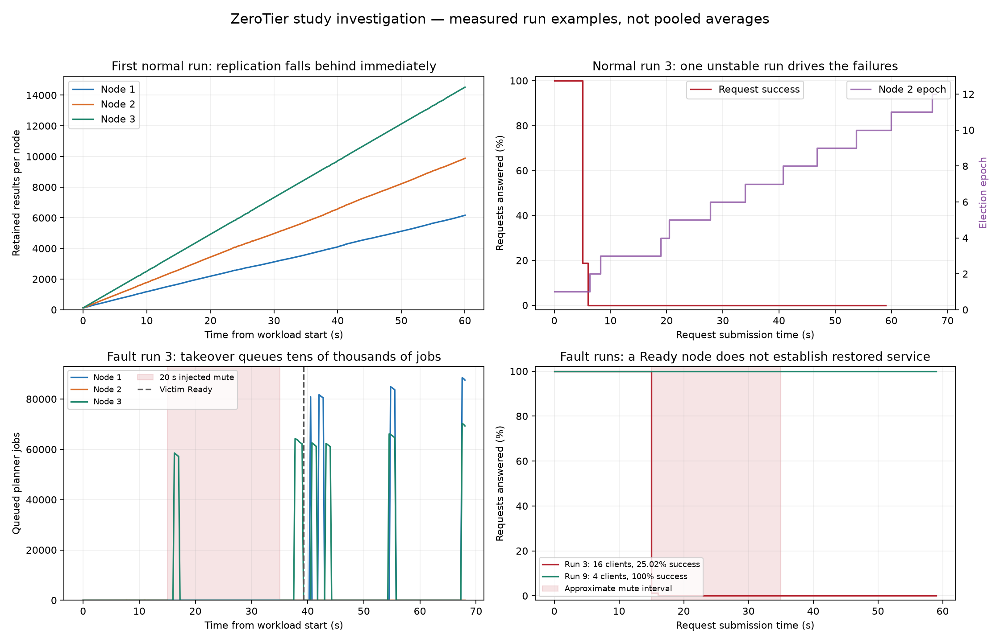

# Investigation of the first mixed-OS ZeroTier study

Source: `zerotier-study-1.zip`, supplied by the user. This investigation reads
all three scenarios' `runs.csv`, `samples.csv` and `requests.csv`, and compares
the observations with the current Rust implementation. Original study files
are preserved. Added artifacts are this note, `investigation-data.json`, and
the PNG/PDF figure in `plots/investigation.*`.

## Conclusion

The evidence supports a chain of replication lag, dropped peer messages,
persistent missing results, and unstable takeover of stale work. Local request
success alone concealed that chain. The failure begins before the injected
outages, so the study does not isolate a healthy cluster's response to a
20-second server failure. Application-level changes and stronger experiment
baseline checks are needed before a repeat study.

The UDP migration made the existing peer sender wait for transport
acknowledgements for each message. The local tests did not establish sustained
replication capacity at the measured network latency. This is a limitation of
the current implementation, rather than evidence that UDP cannot support the
application. The archive cannot isolate the effect of ZeroTier versus the
underlying network; there is no matched direct-LAN or TCP control experiment.

## 1. Missing results match dropped peer messages

The first normal run offered 240 requests/s for 60 seconds. All 14,400 requests
were answered by Node 3, and no node missed a probe during this run. The first
samples show all three nodes holding 120 results (the initial 100-request check
plus the harness warm-up).

| Node | First sample | Last workload sample | Net additions | Approximate additions/s |
|---|---:|---:|---:|---:|
| 1 | 120 | 6,163 | 6,043 | 100.7 |
| 2 | 120 | 9,881 | 9,761 | 162.7 |
| 3, elected server | 120 | 14,520 | 14,400 | 240.0 |

After the convergence wait and next warm-up, the next run starts with counts:

| Node | Results at start of normal run 2 | Deficit relative to Node 3 |
|---|---:|---:|
| 1 | 10,275 | 4,265 |
| 2 | 13,991 | 549 |
| 3 | 14,540 | 0 |

**4,265 + 549 = 4,814**, exactly the first run's `peer_queue_drops` value.
This strongly connects persistent follower deficits with messages discarded
by the peer queues. These early runs occur before the 30-minute table TTL
can explain the differences.

Code evidence: `crates/cloud-node/src/peers.rs` caps each outbound queue at
4,096 messages and drops new messages when full. Its single link task awaits
`write_frame()` before advancing; the UDP writer awaits fragment ACKs.
`ElectBid` and `Replicate` share the FIFO. Consequently acknowledgement latency
limits message throughput, and replication backlog can also delay elections.
The 32-fragment transport window does not pipeline multiple separate messages.

No overflow-triggered state repair is scheduled by that drop path. Recovery
is triggered on configured startup or after a mute. Transport retransmission
does not recover an application message that was discarded before transmission.

## 2. One unstable run caused the normal high-load failures

The five 16-client normal runs were:

| Normal run | Answered / requested | Success | Epoch increases |
|---|---:|---:|---:|
| 3 | 2,490 / 28,800 | 8.65% | 11 |
| 5 | 28,800 / 28,800 | 100% | 0 |
| 7 | 28,800 / 28,800 | 100% | 0 |
| 10 | 28,800 / 28,800 | 100% | 0 |
| 14 | 28,800 / 28,800 | 100% | 0 |

In run 3, the requests submitted in the first five seconds succeeded. Only
90 of the next second's 480 requests succeeded; all requests submitted from
second 6 onward failed. All three nodes answered every recorded probe in this
run. Sampled role views repeatedly change, the epoch rises from 1 to 12, and
queues reach 17,649 jobs. There was no injected failure.

The pooled 81.73% success rate therefore describes a mixture of four perfect
runs and one severe liveness failure. It is not a stable 18.27% loss rate at
480 requests/s, nor evidence of a universal throughput ceiling at that rate.

Code evidence: `node.rs` handles `Action::BecameServer` by taking all
`pending_oldest_first()` entries and using `Pool::force_submit()`, which bypasses
the normal queue capacity. Requests completed on another node but missing from
this node's result table still appear pending. Large stale backlogs and repeated
step-down/takeover are consistent with the observed queues and epoch changes.
Node event logs would be needed to reconstruct each trigger and queued request ID.

## 3. Faults often ended without restored client service

All 15 injections were acknowledged. Sampled victims stop answering for
approximately 20 seconds and then pass through Recovering to Ready.

- 11 of 15 fault runs have no recorded reply computed by a non-victim after
  injection (`failover_ms` is empty).
- In 10 of 15 runs, **no request submitted after injection succeeds at all**.
- All five 16-client fault runs fall in that latter group. Their approximately
  25% success rate corresponds to the initial 15 seconds of a 60-second workload.
- Across fault runs, the epoch increases 149 times. This measures epoch changes,
  not every attempted election.
- Largest observed planner queue: 88,614 jobs, in fault run 1.
- Recovery installation reports range from 0.909 to 15.025 seconds, with a
  median of 4.734 seconds. Time from acknowledged injection to Ready ranges
  from 20.916 to 35.041 seconds, with a median of 24.775 seconds.

There are useful successful cases: fault runs 9 and 12, both at four clients,
answer all 7,200 requests and record failover at 1.146 and 1.305 seconds.
They still do not pass the replica convergence check.

The fault scenario already starts with divergent state. Its first samples
show Node 1 with 154,257 results, Node 2 with 239,924, and Node 3 with 170,115.
Later runs can also start with disagreeing server views. A test beginning in
this condition mixes existing replica damage, takeover of old work, and the
new temporary outage.

## 4. The imbalance case loaded a follower throughout

All 252,000 imbalance requests were answered by Node 2. Every run remains at
epoch 12, with zero epoch increases. Node 1's mean sampled machine CPU load
is approximately 52%, confirming that the artificial CPU load ran.

This demonstrates continued client service while a follower is CPU-loaded.
It does not demonstrate load-triggered reassignment away from a busy incumbent.
In on-demand mode, applying load to a follower does not itself trigger an
election. Initial election under load and loading the elected server should be
separate experiments if those behaviors are part of the report.

## 5. Measurement and recovery limits

- All 756,000 request rows are available; the summary reports zero missing
  records and zero client process failures. Request failures are recorded
  outcomes, not inferred from a missing CSV.
- Client latency is measured only for successful requests. A falling p99 can
  accompany worse availability when slower requests fail and disappear from
  the latency distribution.
- Runs retained server memory and started even after previous convergence
  failed. The harness's pre-run idle check checks phase/queue/running work,
  rather than equal result digests or matching role views.
- After 30 minutes, each node expires results according to its own insertion
  times. Later result-count changes include expiration, so they cannot be
  interpreted as raw replication throughput. Independently expiring old tables
  can also complicate whole-table convergence checks. The early deficits above
  establish a real problem before this complication begins.
- Delta recovery assumes the pre-outage baseline is sound. It does not fetch
  arbitrary old missing results. In addition, `serve_snapshot()` resets the
  entire outbound peer backlog even when it sends only a time-filtered delta.
  An older queued record outside that delta window is not guaranteed to be
  included in the transfer. This is a code-level correctness concern; the
  archive cannot identify individual records lost by this path.
- The 6,659 summed resource-overcommit detections are per-node events, not
  necessarily 6,659 distinct incidents. They warrant checking assignment
  correctness, concurrent server views, and synchronized server clocks.
- The archive contains no server event logs, packet captures, per-peer outbound
  queue samples, final node snapshots or complete server configurations. Those
  omissions limit attribution of exact packet loss and individual state changes.

## Priorities before another large study

1. Increase sustained peer delivery capacity using bounded batching or multiple
   messages in flight; keep elections and other control traffic responsive while
   replication is backlogged. Retain UDP acknowledgements, backoff and bounds.
2. Repair state after dropped replication instead of leaving a Ready follower
   permanently incomplete. Validate the delta baseline and preserve queued
   records not covered by a delta snapshot.
3. Bound takeover work and avoid blindly recomputing large amounts of stale
   history. Coordinate catch-up and scheduling so current requests retain
   a chance to complete within the retry budget.
4. Require a healthy, converged baseline for independent runs, or explicitly
   label continued degraded-state runs as a soak experiment. Record baseline
   and final states, outbound queue depths, dropped message kinds, and server
   logs. Preserve client UUIDs and failed-request elapsed times in merged CSVs.
5. Add sustained delayed-network integration checks. Validate a short normal
   run, an overloaded follower, a loaded incumbent, and a 20-second failure
   separately before a new full sweep. Use a retention/comparison policy that
   does not confuse old-record expiry with current-run replication failure.

Increasing queue capacity or retry counts alone does not establish that
discarded state will be repaired or that election traffic will be timely.
The original study remains valuable as a baseline of the current limitations.

## Focused figure

The selected examples illustrate the early replica deficit, normal run 3's
election instability, a failed fault-run takeover, and a successful failover
at a different offered load. They are individual run examples.

[PDF export](plots/investigation.pdf)
