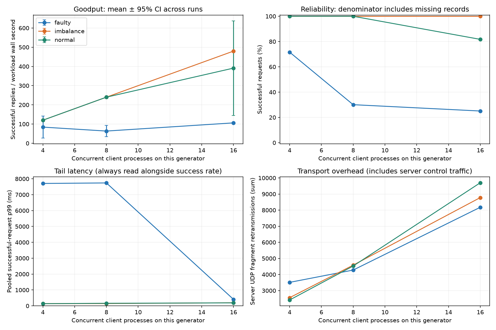
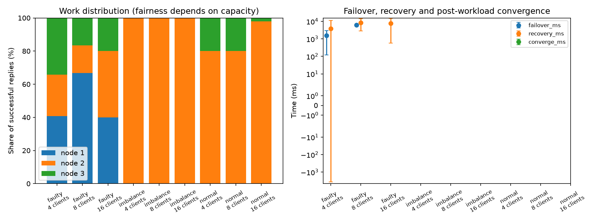
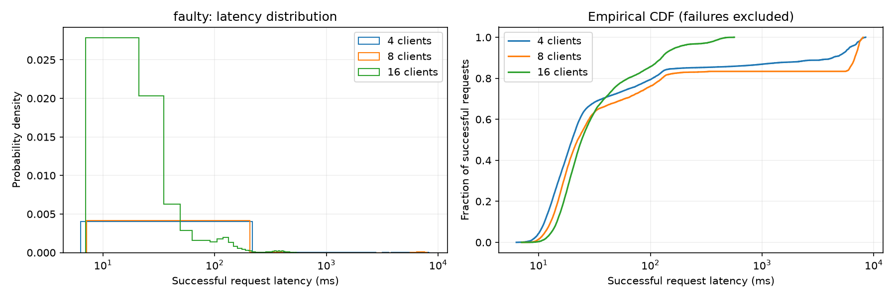
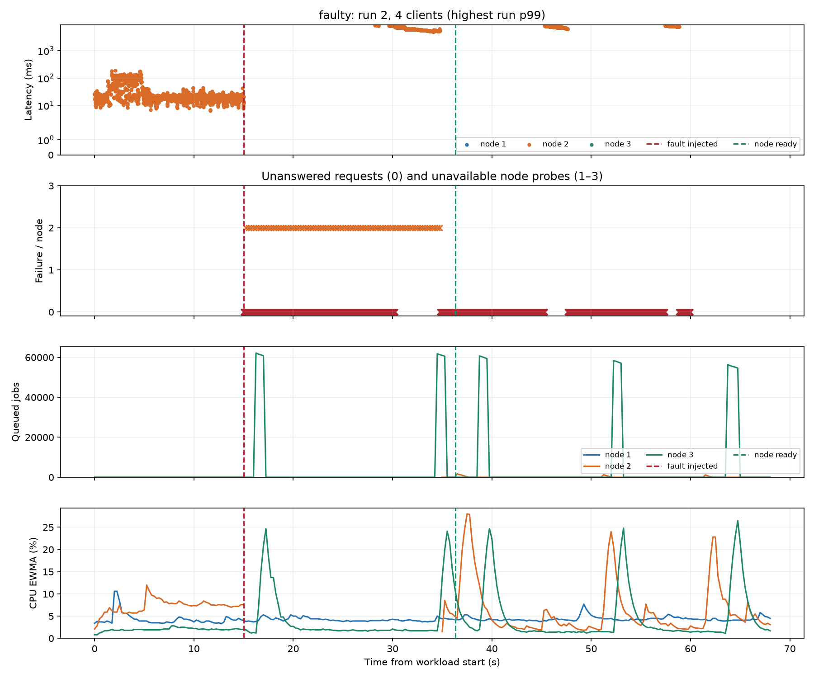
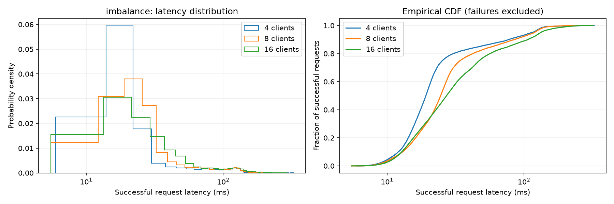
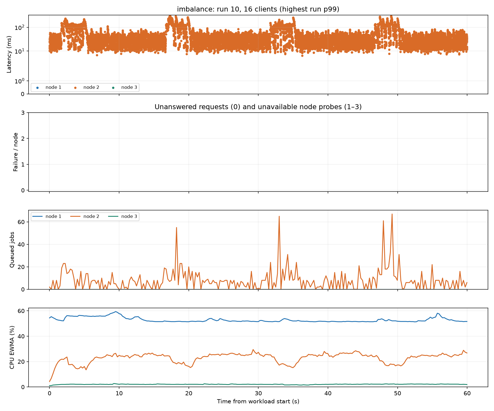
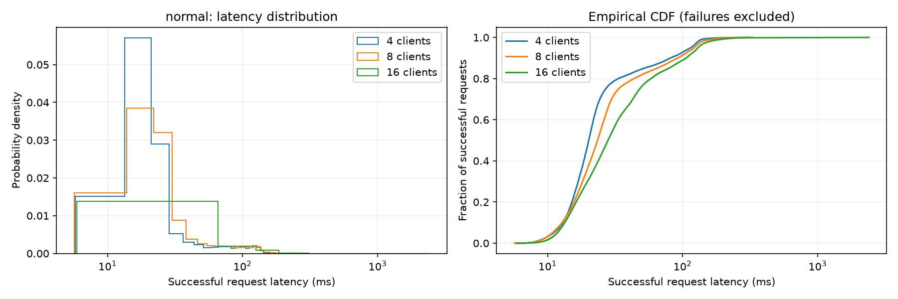
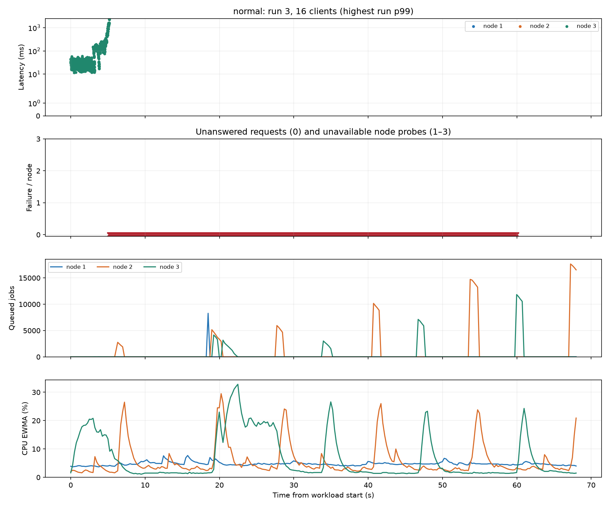

# Phase 1 UDP reliability report

| Scenario | Clients | Runs | Requests | Success % [Wilson 95%] | p50 / p95 / p99 ms | Goodput ± CI | Converged | Faults injected/requested | Missing | Exit failures | Peer drops / overcommits |
|---|---|---|---|---|---|---|---|---|---|---|---|
| faulty | 4 | 5 | 36000 | 71.61 [71.15, 72.08] | 19.89 / 6073.94 / 7707.45 | 84.09 ± 57.24 | 0/5 | 5/5 | 0 | 0 | 47116 / 2212 |
| faulty | 8 | 5 | 72000 | 30.07 [29.73, 30.40] | 22.35 / 7245.38 / 7740.14 | 63.51 ± 29.49 | 0/5 | 5/5 | 0 | 0 | 78511 / 1814 |
| faulty | 16 | 5 | 144000 | 25.06 [24.83, 25.28] | 24.25 / 169.99 / 409.39 | 106.12 ± 0.18 | 0/5 | 5/5 | 0 | 0 | 456002 / 2204 |
| imbalance | 4 | 5 | 36000 | 100.00 [99.99, 100.00] | 19.22 / 113.78 / 140.77 | 119.98 ± 0.07 | 0/5 | 0/0 | 0 | 0 | 0 / 0 |
| imbalance | 8 | 5 | 72000 | 100.00 [99.99, 100.00] | 24.61 / 118.70 / 145.48 | 239.95 ± 0.10 | 0/5 | 0/0 | 0 | 0 | 8931 / 0 |
| imbalance | 16 | 5 | 144000 | 100.00 [100.00, 100.00] | 27.20 / 132.33 / 196.06 | 479.85 ± 0.26 | 0/5 | 0/0 | 0 | 0 | 150081 / 0 |
| normal | 4 | 5 | 36000 | 100.00 [99.99, 100.00] | 20.18 / 115.19 / 137.99 | 120.02 ± 0.02 | 0/5 | 0/0 | 0 | 0 | 0 / 102 |
| normal | 8 | 5 | 72000 | 100.00 [99.99, 100.00] | 23.46 / 121.75 / 162.37 | 240.00 ± 0.03 | 0/5 | 0/0 | 0 | 0 | 5282 / 0 |
| normal | 16 | 5 | 144000 | 81.73 [81.53, 81.93] | 28.02 / 129.94 / 188.97 | 391.23 ± 246.10 | 0/5 | 0/0 | 0 | 0 | 144044 / 327 |

## Load and transport diagnostics

| Scenario | Clients | Retried requests | Busy replies | Peak queue | UDP retransmissions | UDP delivery timeouts | Peak node RSS MiB |
|---|---|---|---|---|---|---|---|
| faulty | 4 | 13597 | 1787 | 62163 | 3511 | 22 | 521.90 |
| faulty | 8 | 53950 | 10581 | 88614 | 4276 | 61 | 529.29 |
| faulty | 16 | 107917 | 17952 | 88417 | 8178 | 149 | 524.95 |
| imbalance | 4 | 0 | 0 | 6 | 2559 | 19 | 317.33 |
| imbalance | 8 | 0 | 0 | 31 | 4581 | 10 | 320.54 |
| imbalance | 16 | 0 | 0 | 67 | 8779 | 15 | 319.60 |
| normal | 4 | 0 | 0 | 6 | 2415 | 17 | 196.31 |
| normal | 8 | 0 | 0 | 22 | 4527 | 10 | 284.99 |
| normal | 16 | 26385 | 3546 | 17649 | 9701 | 28 | 278.41 |

## Interpretation

- Latency distributions include successful replies only; failed and missing operations remain in the success-rate denominator.
- Goodput includes process startup, retries and waiting for failures to exhaust. The older throughput_rps column measures the spacing between successful replies.
- 95% Student-t intervals describe variation across repeated runs. N/A means fewer than two runs. Fresh local clusters isolate repetitions; remote clusters retain history unless explicitly restarted.
- Wilson intervals are an approximate binomial reference; requests share servers and are correlated, so they do not establish real-world reliability. Zero observed failures is not proof of zero failure probability.
- A requested fault without a recorded victim is an invalid fault experiment. Inspect client exit failures, missing records, peer queue drops, resource overcommits and convergence failures.
- Convergence means equal retained result counts/digests after processing becomes idle. It is separate from client success and from the returning node becoming Ready.
- Node counters are process-wide and include diagnostics/ACKs. Retransmissions indicate missing acknowledgements, which may be caused by data loss, ACK loss or delayed processing.
- These are measurements of the named machines, workload and network only. Multi-PC tests should use synchronized clocks; client latency itself uses a monotonic clock.

## Figures

